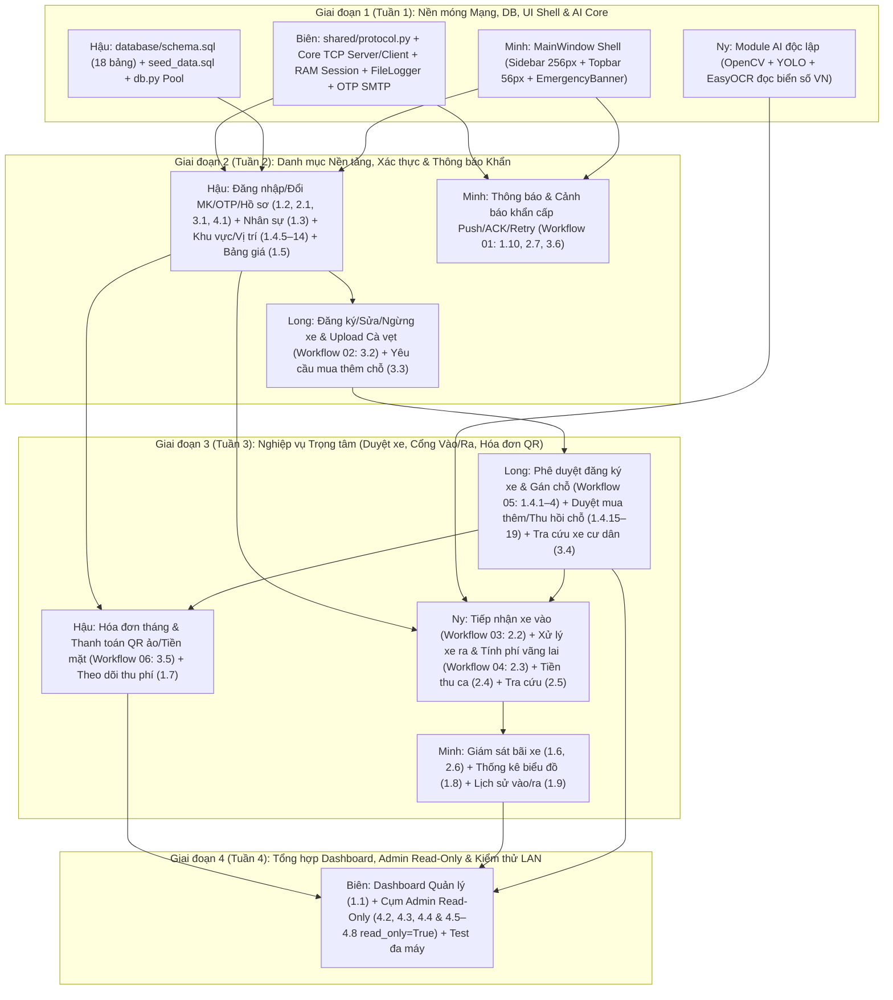
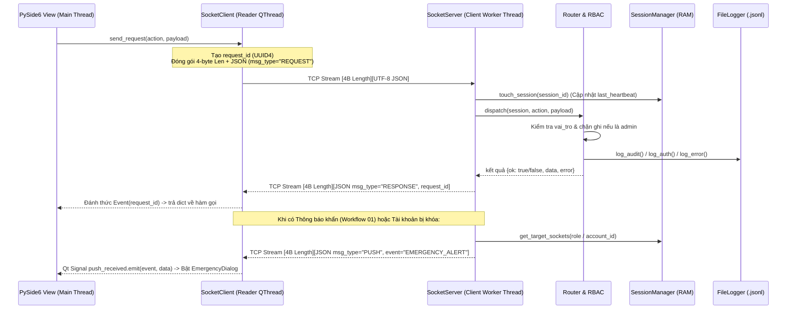

# Kế hoạch Tổng thể 5 Thành viên & Đặc tả Triển khai Chi tiết — Thành viên 1: Leader Biên

Tài liệu này gồm 2 phần:
- **Phần A:** Lộ trình 4 giai đoạn và phân rã toàn bộ các nhóm chức năng riêng lẻ của **5 thành viên (Biên, Hậu, Minh, Long, Ny)** dựa trên [Menu_Bai_xe_Dao_Tien_sieu_cap_V5.html](file:///D:/Lap_trinh_mang/Menu_Bai_xe_Dao_Tien_sieu_cap_V5.html) và [csdl_workflow siu cấp.html](file:///D:/Lap_trinh_mang/csdl_workflow%20siu%20c%E1%BA%A5p.html).
- **Phần B:** Kế hoạch code chi tiết từng file, giao thức mạng và từng chức năng riêng lẻ của **Thành viên 1 — Leader Biên (`feat/core-network`)**.

> [!IMPORTANT]
> **Nguyên tắc kiến trúc bất biến đã chốt:**
> 1. **Ứng dụng Desktop Python (`PySide6`) mô hình Client–Server qua TCP Socket**, dùng 1 kết nối TCP duy nhất mỗi Client (4-byte Length-Prefix Header + UTF-8 JSON, truyền ảnh JPEG dạng `base64` trong JSON).
> 2. **Giữ nguyên tuyệt đối 18 bảng PostgreSQL**, không tạo thêm bảng phụ. Toàn bộ phiên kết nối (`4.3`), OTP khôi phục mật khẩu, phiên xe vãng lai đang gửi và 4 loại nhật ký/lịch sử đều lưu trên **RAM Server + `storage/state/active_vang_lai.json` + File Log `.jsonl` theo ngày**.
> 3. **Đồng bộ giao diện 100%** thông qua [design_dna.json](file:///D:/Lap_trinh_mang/smart_parking/design_dna.json), [tokens.py](file:///D:/Lap_trinh_mang/smart_parking/client/ui/theme/tokens.py), [styles.qss](file:///D:/Lap_trinh_mang/smart_parking/client/ui/theme/styles.qss) và [components.py](file:///D:/Lap_trinh_mang/smart_parking/client/ui/theme/components.py).

---

## PHẦN A: Lộ trình 4 Giai đoạn & Danh mục Chức năng của 5 Thành viên

### 1. Sơ đồ phụ thuộc & Thứ tự triển khai (4 Giai đoạn)



### 2. Tổng hợp phân công từng chức năng riêng lẻ của cả 5 thành viên

| Thành viên (Branch) | Mã nhóm chức năng | Các chức năng riêng lẻ đảm nhận | Bảng CSDL / File Log liên kết |
| :--- | :--- | :--- | :--- |
| **1. Biên – Leader**<br>(`feat/core-network`) | **Hạ tầng Mạng & Log**<br>**`1.1` Dashboard (4)**<br>**`4.2` Tài khoản (5)**<br>**`4.3` Phiên kết nối (2)**<br>**`4.4` Nhật ký (3)**<br>**`4.5–4.8` Admin (14)** | • Core TCP Socket, `SessionManager` (RAM), `PING/PONG`, `FileLogger`, `OTPService` (SMTP thật), `StateStore` (`active_vang_lai.json`), `SocketClient`.<br>• `1.1.1` Yêu cầu chờ duyệt, `1.1.2` Xe đang gửi & chỗ trống, `1.1.3` Doanh thu & phí cư dân, `1.1.4` Cảnh báo hệ thống & bãi xe.<br>• `4.2.1` Xem DS tài khoản, `4.2.2` Xem chi tiết TK, `4.2.3` Xem TK Quản lý, `4.2.4` Xem trạng thái khóa, `4.2.5` Lịch sử trạng thái TK.<br>• `4.3.1` DS phiên đang kết nối, `4.3.2` Chi tiết phiên.<br>• `4.4.1` Nhật ký thao tác, `4.4.2` Nhật ký đăng nhập, `4.4.3` Nhật ký lỗi.<br>• `4.5.1–4.5.3`, `4.6.1–4.6.4`, `4.7.1–4.7.4`, `4.8.1–4.8.3` (gắn `read_only=True` + `ReadOnlyBanner`). | `tai_khoan`, `nhan_vien`, `cu_dan`, RAM `active_sessions`, `auth_*.jsonl`, `audit_*.jsonl`, `error_*.jsonl`, `parking_history_*.jsonl` |
| **2. Hậu**<br>(`feat/db-auth-infra`) | **`1.2/2.1/3.1/4.1` Auth (23)**<br>**`1.3` Nhân sự (10)**<br>**`1.4.5–14` Hạ tầng (10)**<br>**`1.5` Bảng giá (4)**<br>**`3.5` Hóa đơn & QR (4)**<br>**`1.7` Thu phí (4)** | • `schema.sql` (18 bảng + 28 FK), `seed_data.sql`, `db.py`.<br>• Đăng nhập, Đổi MK, Yêu cầu/Gửi lại/Xác minh OTP & Đặt lại MK, Xem/Sửa hồ sơ cá nhân, Đăng xuất (cho 4 vai trò).<br>• `1.3.1–1.3.5` Tạo/Tìm/Xem/Khóa/Mở khóa TK cư dân; `1.3.6–1.3.10` Thêm/Xem/Sửa/Khóa/Mở khóa nhân viên.<br>• `1.4.5–1.4.9` Thêm/Xem/Sửa/Ngừng/Kích hoạt khu vực; `1.4.10–1.4.14` Thêm/Xem/Sửa/Ngừng/Kích hoạt vị trí đỗ.<br>• `1.5.1–1.5.4` Tạo/Sửa/Ngừng/Xem bảng giá.<br>• `3.5.1–3.5.4` Xem DS/Tìm/Chi tiết hóa đơn/Biên nhận + **Workflow 06** (QR ảo có hạn & Tiền mặt tại phòng bảo vệ).<br>• `1.7.1–1.7.4` Khoản phải thu, Đã thu, Tổng hợp thu phí, Chi tiết thanh toán. | `tai_khoan`, `can_ho`, `cu_dan`, `nhan_vien`, `loai_phuong_tien`, `khu_vuc`, `vi_tri_do`, `bang_gia`, `hoa_don_thang`, `giao_dich_thanh_toan` |
| **3. Minh**<br>(`feat/ui-notify-stats`) | **UI Shell (`MainWindow`)**<br>**`1.10/2.7/3.6` Thông báo (9)**<br>**`1.6/2.6` Giám sát (6)**<br>**`1.8` Thống kê (3)**<br>**`1.9` Lịch sử (3)** | • Khung `MainWindow` (Sidebar thu gọn, Topbar trạng thái Socket, chuông thông báo, `EmergencyBanner`).<br>• **Workflow 01**: `1.10.1` Soạn thông báo, `1.10.2` Gửi thông báo (Push real-time + Retry), `1.10.3` Xem đã gửi; `2.7.1–2.7.3` & `3.6.1–3.6.3` Xem DS, Xem nội dung, Xác nhận tiếp nhận & Đánh dấu đã đọc.<br>• `1.6.1–1.6.4` & `2.6.1–2.6.2` Xem xe đang gửi, chỗ trống, chỗ đang dùng, tổng quan & sơ đồ trạng thái.<br>• `1.8.1` Thống kê lượt xe, `1.8.2` Cư dân vs Vãng lai, `1.8.3` Doanh thu (biểu đồ Matplotlib).<br>• `1.9.1` Lịch sử xe vào, `1.9.2` Lịch sử xe ra, `1.9.3` Chi tiết lượt gửi. | `thong_bao`, `nguoi_nhan_thong_bao`, `khu_vuc`, `vi_tri_do`, `bao_cao_luot_va_thu_phi`, `parking_history_*.jsonl` |
| **4. Long**<br>(`feat/vehicle-slots`) | **`3.2` Xe của tôi (5)**<br>**`1.4.1–4` Duyệt xe (4)**<br>**`3.3` Mua chỗ (5)**<br>**`1.4.15–19` Duyệt chỗ (5)**<br>**`3.4` Tra cứu xe (4)** | • **Workflow 02**: `3.2.1` Gửi đăng ký xe (+ upload ảnh cà vẹt qua Socket), `3.2.2` Xem DS xe, `3.2.3` Chi tiết xe, `3.2.4` Yêu cầu sửa thông tin xe, `3.2.5` Gửi yêu cầu ngừng đăng ký.<br>• **Workflow 05**: `1.4.1` Xem DS xe, `1.4.2` Phê duyệt đăng ký xe (ô tô gán vị trí cố định, xe máy gán khu vực), `1.4.3` Từ chối đăng ký, `1.4.4` Ngừng hiệu lực.<br>• `3.3.1–3.3.5` Gửi yêu cầu mua thêm chỗ ô tô, Xem tiến độ, Hủy yêu cầu, Xem DS & trạng thái chỗ được cấp.<br>• `1.4.15–1.4.19` Xem DS/Chi tiết yêu cầu mua chỗ, Phê duyệt cấp thêm chỗ, Từ chối, Thu hồi quyền sử dụng chỗ.<br>• `3.4.1–3.4.4` Xem xe đang gửi, Vị trí xe, Lịch sử gửi xe, Chi tiết lượt gửi của cư dân. | `can_ho`, `phuong_tien`, `yeu_cau_dang_ky_xe`, `yeu_cau_mua_them_cho`, `phan_bo_cho_do`, `quan_ly_phuong_tien_ra_vao`, `vi_tri_do` |
| **5. Ny**<br>(`feat/gate-ai-ocr`) | **AI Camera & OCR**<br>**`2.2` Xe vào (4)**<br>**`2.3` Xe ra (4)**<br>**`2.4` Tiền thu ca (1)**<br>**`2.5` Tra cứu NV (3)** | • `camera_worker.py` + `plate_recognizer.py` (`OpenCV + YOLO + EasyOCR` nhận diện & chuẩn hóa biển số VN, quét lại khi mờ).<br>• **Workflow 03 (`2.2`)**: `2.2.1` Quét biển số vào, `2.2.2` Tra cứu đăng ký, `2.2.3.1` Ghi nhận xe vào Cư dân, `2.2.3.2` Ghi nhận xe vào Khách vãng lai (lưu RAM + `active_vang_lai.json`).<br>• **Workflow 04 (`2.3`)**: `2.3.1` Quét biển số ra, `2.3.2.1` Tra cứu lượt mở Cư dân (không thu tiền), `2.3.2.2` Tra cứu & tính tiền Khách vãng lai (ô tô theo giờ, xe máy theo lượt), `2.3.3` Xác nhận xe ra (giải phóng chỗ, ghi `parking_history_*.jsonl`, cộng dồn `bao_cao_luot_va_thu_phi`).<br>• `2.4` Xem số tiền đã thu trong ca; `2.5.1–2.5.3` Tìm xe theo biển số, Xem vị trí xe, Xem lịch sử lượt gửi. | `phuong_tien`, `quan_ly_phuong_tien_ra_vao`, `khu_vuc`, `vi_tri_do`, `bang_gia`, `bao_cao_luot_va_thu_phi`, `active_vang_lai.json`, `parking_history_*.jsonl` |

---

## PHẦN B: Kế hoạch Triển khai Chi tiết cho Thành viên 1 — Leader Biên

### 1. Kiến trúc Giao thức TCP Socket & Luồng Xử lý của Biên



---

### 2. Proposed Changes (Danh sách File của Leader Biên)

#### Component 1: Tầng Hợp đồng & Hằng số Dùng chung (`shared/`)

##### [NEW] [constants.py](file:///D:/Lap_trinh_mang/smart_parking/shared/constants.py)
Định nghĩa toàn bộ Enum/Hằng số khớp 100% với 18 bảng CSDL trong [csdl_workflow siu cấp.html](file:///D:/Lap_trinh_mang/csdl_workflow%20siu%20c%E1%BA%A5p.html):
- `Roles`: `QUAN_LY = "quan_ly"`, `NHAN_VIEN = "nhan_vien"`, `CU_DAN = "cu_dan"`, `ADMIN = "admin"`
- `AccountStatus`: `HOAT_DONG = "hoat_dong"`, `TAM_KHOA = "tam_khoa"`
- `VehicleTypes`: `O_TO = "O_TO"`, `XE_MAY = "XE_MAY"`
- `SlotStatus`: `TRONG = "trong"`, `DA_PHAN_CHO = "da_phan_cho"`, `DANG_CO_XE = "dang_co_xe"`, `NGUNG_SU_DUNG = "ngung_su_dung"`
- `RequestStatus`: `CHO_DUYET = "cho_duyet"`, `DA_DUYET = "da_duyet"`, `TU_CHOI = "tu_choi"`, `DA_HUY = "da_huy"`
- `InvoiceStatus`: `CHUA_THANH_TOAN = "chua_thanh_toan"`, `DA_THANH_TOAN = "da_thanh_toan"`, `QUA_HAN = "qua_han"`
- `NotifyTypes` & `NotifyLevels`, `ShiftTypes` (`ca_sang`, `ca_chieu`, `ca_dem`).

##### [NEW] [protocol.py](file:///D:/Lap_trinh_mang/smart_parking/shared/protocol.py)
Đặc tả đóng gói khung tin TCP (`4-byte big-endian length` + `UTF-8 JSON`) và danh mục toàn bộ `Actions` & `PushEvents`:
```python
import json
import socket
import struct
import uuid
from typing import Any, Dict, Optional

HEADER_STRUCT = struct.Struct("!I")  # 4-byte unsigned int big-endian
MAX_FRAME_SIZE = 16 * 1024 * 1024    # Tối đa 16MB (đủ cho ảnh cà vẹt/camera base64)

class MsgType:
    REQUEST = "REQUEST"
    RESPONSE = "RESPONSE"
    PUSH = "PUSH"

class Actions:
    # Hệ thống & Phiên (Biên)
    PING = "system.ping"
    DASHBOARD_SUMMARY = "manager.dashboard_summary"       # 1.1.1 - 1.1.4
    ADMIN_LIST_ACCOUNTS = "admin.list_accounts"           # 4.2.1
    ADMIN_GET_ACCOUNT = "admin.get_account"               # 4.2.2, 4.2.3, 4.2.4
    ADMIN_ACCOUNT_HISTORY = "admin.account_status_history"# 4.2.5
    ADMIN_LIST_SESSIONS = "admin.list_sessions"           # 4.3.1
    ADMIN_GET_SESSION = "admin.get_session"               # 4.3.2
    ADMIN_QUERY_LOGS = "admin.query_logs"                 # 4.4.1, 4.4.2, 4.4.3
    # Các nhóm Action của Hậu (auth.*, hr.*, infra.*, pricing.*, billing.*)
    # Các nhóm Action của Minh (notify.*, monitor.*, stats.*, history.*)
    # Các nhóm Action của Long (vehicle.*, slot_request.*, allocation.*)
    # Các nhóm Action của Ny (gate.*, shift.*)

class PushEvents:
    EMERGENCY_ALERT = "push.emergency_alert"              # Workflow 01
    NORMAL_NOTIFICATION = "push.normal_notification"
    SESSION_REVOKED = "push.session_revoked"              # Khi bị khóa TK hoặc đổi MK
    PARKING_STATE_CHANGED = "push.parking_state_changed"  # Cập nhật sơ đồ ô đỗ

def send_frame(sock: socket.socket, message: Dict[str, Any]) -> None:
    raw = json.dumps(message, ensure_ascii=False).encode("utf-8")
    sock.sendall(HEADER_STRUCT.pack(len(raw)) + raw)

def recv_frame(sock: socket.socket) -> Optional[Dict[str, Any]]:
    header = _recv_exact(sock, HEADER_STRUCT.size)
    if not header:
        return None
    (length,) = HEADER_STRUCT.unpack(header)
    if length <= 0 or length > MAX_FRAME_SIZE:
        raise ValueError(f"Kích thước gói tin không hợp lệ: {length}")
    payload = _recv_exact(sock, length)
    if not payload:
        return None
    return json.loads(payload.decode("utf-8"))
```

##### [NEW] [validators.py](file:///D:/Lap_trinh_mang/smart_parking/shared/validators.py)
Các hàm chuẩn hóa & kiểm tra hợp lệ dùng chung cho cả Client và Server:
- `normalize_plate(plate: str) -> str`: Chuẩn hóa biển số VN (viết hoa, bỏ khoảng trắng thừa, chuẩn dấu gạch ngang/chấm).
- `validate_email(email: str) -> bool`, `validate_phone(phone: str) -> bool`, `validate_cccd(cccd: str) -> bool`.
- `encode_image_base64(file_path: str, max_bytes: int = 400_000) -> str` và `save_base64_image(b64_str: str, dest_dir: Path, prefix: str) -> str`.

---

#### Component 2: Lõi TCP Server, RAM Session, File Log, OTP & State Store (`server/`)

##### [NEW] [config.py](file:///D:/Lap_trinh_mang/smart_parking/server/config.py)
Đọc biến môi trường từ `.env` (`SERVER_HOST`, `SERVER_PORT`, `DB_*`, `SMTP_*`, `OTP_EXPIRE_SECONDS=300`, `HEARTBEAT_TIMEOUT_SECONDS=45`) và khởi tạo đường dẫn `storage/state/`, `storage/logs/`, `storage/uploads/`.

##### [NEW] [session_manager.py](file:///D:/Lap_trinh_mang/smart_parking/server/core/session_manager.py)
Quản lý toàn bộ phiên kết nối trên RAM phục vụ trực tiếp mục **`4.3.1`**, **`4.3.2`**, hủy phiên khi khóa tài khoản (**`1.3.4`**, **`1.3.9`**) và định tuyến Server Push:
- Lưu cấu trúc `ClientSession`: `session_id`, `sock`, `send_lock`, `ip_address`, `port`, `ma_tai_khoan`, `ten_dang_nhap`, `vai_tro`, `connected_at`, `last_heartbeat`, `trang_thai_ket_noi`.
- `register_connection(sock, addr) -> ClientSession`
- `bind_authenticated_user(session_id, account_dict)`
- `touch(session_id)`: Cập nhật `last_heartbeat` mỗi khi nhận `PING` hoặc bất kỳ `REQUEST` nào.
- `revoke_user_sessions(ma_tai_khoan, reason)`: Gửi gói `PUSH` (`SESSION_REVOKED`) tới mọi phiên đang mở của tài khoản bị khóa/đặt lại mật khẩu rồi đóng socket.
- `push_to_users(account_ids, event, data)` & `push_to_roles(roles, event, data)`: Trả về danh sách `ma_tai_khoan` gửi thành công (`gui_thanh_cong`) và thất bại (`gui_that_bai`) để hỗ trợ chính xác hình thoi *"Gửi thông báo?"* trong **Workflow 01**.
- Luồng ngầm `reap_stale_sessions()`: Quét mỗi 10s, nếu `now - last_heartbeat > 45s` thì đóng phiên, xóa khỏi RAM và ghi `PING_TIMEOUT` vào `error_YYYY-MM-DD.jsonl`.

##### [NEW] [file_logger.py](file:///D:/Lap_trinh_mang/smart_parking/server/core/file_logger.py)
Ghi nối (append-only, thread-safe bằng `RLock`) và truy vấn ngược 4 loại File Log `.jsonl` theo ngày trong `storage/logs/`:
1. `auth_YYYY-MM-DD.jsonl`: Lưu `{timestamp, ma_tai_khoan, ten_dang_nhap, vai_tro, ip_address, ket_qua, ly_do}` $\rightarrow$ phục vụ **`4.4.2` Xem nhật ký đăng nhập**.
2. `audit_YYYY-MM-DD.jsonl`: Lưu `{timestamp, ma_tai_khoan, ten_dang_nhap, vai_tro, loai_thao_tac, doi_tuong, ma_doi_tuong, gia_tri_cu, gia_tri_moi}` $\rightarrow$ phục vụ **`4.4.1` Xem nhật ký thao tác** và **`4.2.5` Tra cứu lịch sử trạng thái tài khoản**.
3. `error_YYYY-MM-DD.jsonl`: Lưu `{timestamp, muc_do, nguon, ma_loi, noi_dung, chi_tiet}` $\rightarrow$ phục vụ **`4.4.3` Xem nhật ký lỗi hệ thống** và **`1.1.4` Cảnh báo hệ thống và bãi xe**.
4. `parking_history_YYYY-MM-DD.jsonl`: Lưu `{timestamp, ma_luot_gui, loai_khach, bien_so_xe, ma_loai_xe, ma_khu_vuc, ma_vi_tri, thoi_gian_vao, thoi_gian_ra, anh_vao, anh_ra, tien_thu, ma_nhan_vien_vao, ma_nhan_vien_ra, trang_thai}` $\rightarrow$ phục vụ **`1.9`**, **`2.4`**, **`2.5.3`**, **`3.4.3`**, **`4.7.3`**.

##### [NEW] [state_store.py](file:///D:/Lap_trinh_mang/smart_parking/server/core/state_store.py)
Quản lý trạng thái **Phiên xe vãng lai đang trong bãi** trên RAM đồng bộ tức thì xuống `storage/state/active_vang_lai.json`:
- Khi Server khởi động: Tự động nạp `active_vang_lai.json` lên RAM (đảm bảo mất điện/restart Server không mất giờ vào của khách vãng lai).
- Cung cấp hàm thread-safe cho Ny gọi: `add_visitor_session(...)`, `get_open_visitor_by_plate(bien_so)`, `pop_visitor_session(ma_luot_gui)`, `list_open_visitor_sessions(ma_khu_vuc=None)`.

##### [NEW] [otp_service.py](file:///D:/Lap_trinh_mang/smart_parking/server/core/otp_service.py)
Quản lý OTP khôi phục mật khẩu trên RAM (không lưu DB) và gửi Email thật qua `smtplib`:
- Lưu RAM `{request_id: {email, ma_tai_khoan, otp_code, expires_at, resend_available_at, reset_token, verified}}`.
- Hỗ trợ đầy đủ 4 bước riêng lẻ (`4.1.3` Yêu cầu OTP, `4.1.4` Gửi lại OTP có đếm ngược 60s và vô hiệu mã cũ, `4.1.5` Xác minh OTP cấp `reset_token` có hạn, `4.1.6` Đặt lại mật khẩu và thu hồi toàn bộ phiên cũ) cũng như mục gộp `1.2.3`, `2.1.3`, `3.1.3`.

##### [NEW] [router.py](file:///D:/Lap_trinh_mang/smart_parking/server/core/router.py) & [socket_server.py](file:///D:/Lap_trinh_mang/smart_parking/server/core/socket_server.py) & [main.py](file:///D:/Lap_trinh_mang/smart_parking/server/main.py)
- `Router`: Cho phép 5 thành viên đăng ký handler `router.register(action, handler_fn, allowed_roles=[...], is_mutation=True/False)`. Tự động chặn mọi `is_mutation=True` nếu `session.vai_tro == "admin"`.
- `SocketServer`: `ThreadingTCPServer` lắng nghe kết nối, đọc/ghi frame qua `protocol.py`, tự động bắt ngoại lệ ghi vào `error_YYYY-MM-DD.jsonl` để Server không bao giờ sập khi 1 Client gửi dữ liệu lỗi.

---

#### Component 3: Handler Nghiệp vụ của Biên (`server/handlers/monitor_admin_handler.py`)

##### [NEW] [monitor_admin_handler.py](file:///D:/Lap_trinh_mang/smart_parking/server/handlers/monitor_admin_handler.py)
Xử lý trực tiếp các chức năng riêng lẻ do Biên đảm nhận:
1. **Nhóm `1.1` Dashboard tổng quan Quản lý:**
   - `1.1.1 Yêu cầu đang chờ duyệt`: Đếm & lấy danh sách rút gọn từ `yeu_cau_dang_ky_xe` (`trang_thai_duyet = 'cho_duyet'`) và `yeu_cau_mua_them_cho` (`trang_thai_duyet = 'cho_duyet'`).
   - `1.1.2 Xe đang gửi và chỗ còn trống`: Tổng hợp từ `khu_vuc`, `vi_tri_do` (`trong`, `dang_co_xe`, `da_phan_cho`, `ngung_su_dung`), `quan_ly_phuong_tien_ra_vao` (`dang_trong_bai = TRUE`) + số phiên trong `state_store` (`active_vang_lai`).
   - `1.1.3 Doanh thu và phí cư dân`: Tổng hợp `tong_tien_phai_thu`, đã thu (`da_thanh_toan`), còn nợ (`chua_thanh_toan`, `qua_han`) từ `hoa_don_thang`, `giao_dich_thanh_toan` và `bao_cao_luot_va_thu_phi`.
   - `1.1.4 Cảnh báo hệ thống và bãi xe`: Lấy các cảnh báo/lỗi mới nhất từ `error_YYYY-MM-DD.jsonl` (mất kết nối camera/socket, vị trí ngừng sử dụng, lỗi nhận diện).
2. **Nhóm `4.2` Quản lý tài khoản hệ thống (Admin chỉ xem):**
   - `4.2.1 Xem danh sách tài khoản`: Lọc theo `vai_tro`, `trang_thai`, `ten_dang_nhap` (ẩn `mat_khau_bam`).
   - `4.2.2 Xem chi tiết tài khoản`: Join `tai_khoan` với `cu_dan` hoặc `nhan_vien` + lấy lần đăng nhập gần nhất từ `auth_*.jsonl`.
   - `4.2.3 Xem thông tin tài khoản Quản lý chung cư`: Lọc các tài khoản `vai_tro = 'quan_ly'` kèm hồ sơ `nhan_vien`.
   - `4.2.4 Xem trạng thái khóa tài khoản`: Trả về `trang_thai`, `ly_do_khoa` và thời điểm cập nhật gần nhất.
   - `4.2.5 Tra cứu lịch sử trạng thái tài khoản`: Lọc từ `audit_*.jsonl` các thao tác khóa/kích hoạt lại tài khoản theo `ma_tai_khoan` và khoảng ngày.
3. **Nhóm `4.3` Phiên kết nối (Admin chỉ xem):**
   - `4.3.1 Xem danh sách phiên đang kết nối`: Lấy từ RAM `SessionManager`, lọc theo `vai_tro`, `ten_dang_nhap`.
   - `4.3.2 Xem chi tiết phiên kết nối`: Xem chi tiết `session_id`, IP:Port, tài khoản, thời điểm kết nối, `last_heartbeat`, trạng thái.
4. **Nhóm `4.4` Nhật ký hệ thống (Admin chỉ xem):**
   - `4.4.1 Xem nhật ký thao tác`: Đọc `audit_*.jsonl` theo khoảng ngày, tài khoản, loại thao tác.
   - `4.4.2 Xem nhật ký đăng nhập`: Đọc `auth_*.jsonl` theo khoảng ngày, tài khoản, kết quả (`thanh_cong`, `that_bai`, `bi_khoa`).
   - `4.4.3 Xem nhật ký lỗi hệ thống`: Đọc `error_*.jsonl` theo khoảng ngày, mức độ (`INFO`, `WARN`, `ERROR`).

---

#### Component 4: Client Network & Giao diện Dashboard + Admin của Biên (`client/`)

##### [NEW] [socket_client.py](file:///D:/Lap_trinh_mang/smart_parking/client/network/socket_client.py)
- Duy trì 1 kết nối TCP, có `QThread` đọc frame liên tục:
  - Khi nhận `msg_type == "RESPONSE"`: Lưu vào bảng chờ theo `request_id` và đánh thức `threading.Event` để hàm `call(action, payload, timeout=10.0)` trả kết quả đồng bộ dễ dùng.
  - Khi nhận `msg_type == "PUSH"`: Phát `Signal` `push_received(str, dict)` lên Main Thread của `PySide6` (để bật `EmergencyDialog`, cập nhật sơ đồ bãi hoặc văng về màn hình Login nếu tài khoản bị khóa).
- Tự động chạy `QTimer` mỗi `15000ms` gửi `Actions.PING` ngầm.

##### [NEW] [dashboard_view.py](file:///D:/Lap_trinh_mang/smart_parking/client/ui/manager/dashboard_view.py)
Giao diện **Mục `1.1` Dashboard tổng quan** cho Quản lý chung cư (sử dụng `StatCard`, `SectionCard`, `StatusBadge`, `style_table` từ `components.py`):
- 4 thẻ `StatCard` hàng đầu tương ứng `1.1.1` (Yêu cầu chờ duyệt), `1.1.2` (Xe đang gửi / Chỗ trống), `1.1.3` (Doanh thu & Công nợ tháng), `1.1.4` (Cảnh báo cần xử lý).
- Bảng đôi bên dưới: Danh sách yêu cầu đăng ký xe & mua thêm chỗ đang chờ duyệt (`1.1.1`) và Danh sách cảnh báo hệ thống/bãi xe mới nhất (`1.1.4`) kèm nút làm mới tức thời.

##### [NEW] [admin_views.py](file:///D:/Lap_trinh_mang/smart_parking/client/ui/admin/admin_views.py)
Giao diện cho vai trò **Admin (`4.2 – 4.8`)**, mọi màn hình đều gắn `ReadOnlyBanner` ở trên cùng:
- `AdminAccountsView` (`4.2.1 – 4.2.5`): Bảng danh sách tài khoản, bộ lọc vai trò/trạng thái, tab xem riêng Quản lý chung cư (`4.2.3`), Dialog xem chi tiết hồ sơ & lịch sử khóa/mở khóa (`4.2.2`, `4.2.4`, `4.2.5`).
- `AdminSessionsView` (`4.3.1 – 4.3.2`): Bảng phiên kết nối real-time từ RAM Server (IP:Port, Vai trò, Giờ kết nối, Lần phản hồi gần nhất) + Dialog chi tiết phiên.
- `AdminLogsView` (`4.4.1 – 4.4.3`): 3 sub-tab xem Nhật ký thao tác (hiển thị rõ `Giá trị cũ` $\rightarrow$ `Giá trị mới`), Nhật ký đăng nhập và Nhật ký lỗi hệ thống.
- `AdminReadOnlyWrapper` (`4.5 – 4.8`): Khung bọc tái sử dụng các View của Quản lý (Giám sát `4.5`, Dữ liệu nghiệp vụ `4.6`, Tài chính/Thống kê/Lịch sử `4.7`, Thông báo hệ thống `4.8`) với cờ `read_only=True` (tự động vô hiệu hóa/ẩn toàn bộ nút Thêm, Sửa, Xóa, Duyệt, Thu hồi, Phát hành).

---

## Verification Plan (Kế hoạch Kiểm thử Phần của Leader Biên)

### 1. Automated Tests (`tests/`)
Viết bộ unit/integration test tự động trong `tests/test_leader_core.py` (chạy được ngay bằng `pytest` hoặc `unittest` không cần bật DB thật nhờ mock handler):
- **Test đóng gói Framing & Ảnh Base64:** Gửi liên tiếp 20 gói JSON lớn (kèm chuỗi ảnh base64 200KB) qua `socketpair` để xác minh không bị cắt gói hoặc dính gói TCP.
- **Test đồng thời `REQUEST/RESPONSE` + `PUSH`:** Client vừa gửi 10 request liên tục, Server vừa bắn xen kẽ 3 gói `PUSH` (`EMERGENCY_ALERT`) trên cùng 1 socket $\rightarrow$ xác minh Client nhận đủ cả 10 response đúng `request_id` và 3 sự kiện Push.
- **Test `SessionManager` & Chặn quyền `Admin`:** Đăng nhập phiên `admin`, thử gọi một action có `is_mutation=True` $\rightarrow$ `Router` tự động từ chối trả lỗi phân quyền và ghi log.
- **Test `FileLogger` & `StateStore`:** Ghi 5 lượt xe vãng lai vào `StateStore`, khởi tạo lại instance `StateStore` từ file `active_vang_lai.json` $\rightarrow$ dữ liệu khôi phục 100%; kiểm tra ghi và lọc `auth/audit/error/parking_history.jsonl`.

Chạy kiểm tra bằng lệnh:
```powershell
python -m unittest discover -s D:\Lap_trinh_mang\smart_parking\tests -p "test_*.py" -v
```

### 2. Manual Verification
1. Chạy `python -m server.main` trên 1 cửa sổ terminal.
2. Chạy script/app Client kết nối vào Server, kiểm tra gói `PING` tự động cập nhật `last_heartbeat` mỗi 15s trên `SessionManager`.
3. Mở giao diện `DashboardView` (`1.1`) và `AdminSessionsView` / `AdminLogsView` (`4.2 – 4.4`) kiểm tra hiển thị đúng chuẩn Design DNA.
