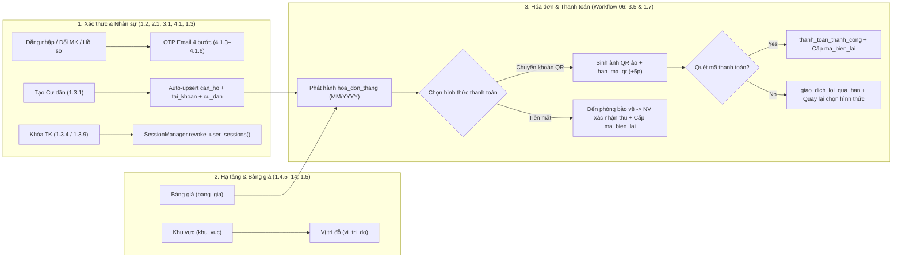

# Kế hoạch Triển khai Chi tiết — Thành viên 2: Hậu (`feat/db-auth-infra`)

Tài liệu này đặc tả toàn bộ thiết kế kỹ thuật, cấu trúc file và kế hoạch code **từng chức năng riêng lẻ** của **Thành viên 2 — Hậu** trên nhánh `feat/db-auth-infra`, bám sát 100% [Menu_Bai_xe_Dao_Tien_sieu_cap_V5.html](file:///D:/Lap_trinh_mang/Menu_Bai_xe_Dao_Tien_sieu_cap_V5.html), [csdl_workflow siu cấp.html](file:///D:/Lap_trinh_mang/csdl_workflow%20siu%20c%E1%BA%A5p.html) và bộ [DESIGN_SYSTEM.md](file:///D:/Lap_trinh_mang/smart_parking/DESIGN_SYSTEM.md).

> [!IMPORTANT]
> **Các quyết định thiết kế đã chốt cho phần của Hậu:**
> 1. **Giữ nguyên 100% cấu trúc 18 bảng và 28 khóa ngoại (FK)** trong PostgreSQL, không thêm bất kỳ bảng phụ nào.
> 2. **Tự động đảm bảo toàn vẹn khóa ngoại `can_ho` khi tạo Cư dân (`1.3.1`):** Cho phép chọn căn hộ có sẵn hoặc nhập mã căn hộ mới (ví dụ `A12-05`); nếu mã chưa tồn tại trong bảng `can_ho`, Server tự động tách Tòa/Tầng và `INSERT INTO can_ho` (`so_cho_oto_mac_dinh = 1`, `so_cho_oto_mua_them = 0`) trong cùng transaction trước khi tạo hồ sơ `cu_dan`.
> 3. **Kiểm tra điều kiện chặt tại Server:** Khu vực chỉ được ngừng sử dụng khi `so_xe_dang_gui == 0` (`1.4.8`); Vị trí đỗ chỉ được ngừng khi `trang_thai_vi_tri != 'dang_co_xe'` (`1.4.13`); Sửa bảng giá (`1.5.2`) giữ nguyên căn cứ giá của các hóa đơn/giao dịch cũ.
> 4. **Khớp 100% sơ đồ `Workflow 06` (Thanh toán phí hàng tháng):** Hỗ trợ tự động phát hành hóa đơn kỳ `MM/YYYY`, nhánh **Chuyển khoản QR ảo** có đồng hồ đếm ngược kèm 2 nút mô phỏng cả nhánh `Yes` (thành công) và nhánh `No` (giao dịch lỗi/quá hạn quay lại chọn hình thức), và nhánh **Tiền mặt** tại phòng bảo vệ có lưu `ma_nhan_vien_thu` + cấp `ma_bien_lai`.

---

## 1. Sơ đồ Luồng Nghiệp vụ của Hậu (Auth, Hạ tầng & Workflow 06)

---

## 2. Proposed Changes (Danh sách File & Đặc tả Chức năng của Hậu)

### Component 1: Cơ sở dữ liệu PostgreSQL 18 Bảng & Connection Pool (`database/`, `server/db.py`)

#### [NEW] [schema.sql](file:///D:/Lap_trinh_mang/smart_parking/database/schema.sql)
Chuyển đổi chính xác 18 bảng và 28 khóa ngoại từ [csdl_workflow siu cấp.html](file:///D:/Lap_trinh_mang/csdl_workflow%20siu%20c%E1%BA%A5p.html) sang cú pháp chuẩn PostgreSQL:
- **11 bảng đối tượng nền tảng:**
  1. `tai_khoan` (`ma_tai_khoan INT GENERATED ALWAYS AS IDENTITY PRIMARY KEY`, `ten_dang_nhap VARCHAR(50) UNIQUE NOT NULL`, `mat_khau_bam VARCHAR(255) NOT NULL`, `vai_tro VARCHAR(20) NOT NULL`, `trang_thai VARCHAR(20) NOT NULL`, `ly_do_khoa VARCHAR(255)`, `ngay_tao TIMESTAMP NOT NULL DEFAULT CURRENT_TIMESTAMP`)
  2. `can_ho` (`ma_can_ho VARCHAR(20) PRIMARY KEY`, `toa_nha VARCHAR(20) NOT NULL`, `so_tang INT NOT NULL`, `so_cho_oto_mac_dinh INT NOT NULL DEFAULT 1`, `so_cho_oto_mua_them INT NOT NULL DEFAULT 0`, `trang_thai_can_ho VARCHAR(25) NOT NULL DEFAULT 'dang_su_dung'`)
  3. `cu_dan` (`ma_cu_dan INT GENERATED ALWAYS AS IDENTITY PRIMARY KEY`, `ma_tai_khoan INT UNIQUE NOT NULL REFERENCES tai_khoan(ma_tai_khoan)`, `ma_can_ho VARCHAR(20) NOT NULL REFERENCES can_ho(ma_can_ho)`, `ho_ten VARCHAR(100) NOT NULL`, `so_cccd VARCHAR(20) UNIQUE NOT NULL`, `so_dien_thoai VARCHAR(15) NOT NULL`, `email VARCHAR(100) UNIQUE NOT NULL`, `dia_chi VARCHAR(255)`)
  4. `nhan_vien` (`ma_nhan_vien INT GENERATED ALWAYS AS IDENTITY PRIMARY KEY`, `ma_tai_khoan INT UNIQUE NOT NULL REFERENCES tai_khoan(ma_tai_khoan)`, `ma_nhan_vien_code VARCHAR(20) UNIQUE NOT NULL`, `ho_ten VARCHAR(100) NOT NULL`, `so_cccd VARCHAR(20) UNIQUE NOT NULL`, `so_dien_thoai VARCHAR(15) NOT NULL`, `email VARCHAR(100) UNIQUE NOT NULL`, `chuc_vu VARCHAR(30) NOT NULL`)
  5. `loai_phuong_tien` (`ma_loai_xe VARCHAR(20) PRIMARY KEY`, `ten_loai_xe VARCHAR(50) NOT NULL`, `kieu_phan_cho VARCHAR(30) NOT NULL`, `mo_ta VARCHAR(255)`)
  6. `khu_vuc` (`ma_khu_vuc VARCHAR(20) PRIMARY KEY`, `ten_khu_vuc VARCHAR(100) NOT NULL`, `ma_loai_xe VARCHAR(20) NOT NULL REFERENCES loai_phuong_tien(ma_loai_xe)`, `tong_so_cho INT NOT NULL DEFAULT 0`, `so_xe_dang_gui INT NOT NULL DEFAULT 0`, `trang_thai_khu_vuc VARCHAR(25) NOT NULL DEFAULT 'hoat_dong'`, `ly_do_ngung VARCHAR(255)`)
  7. `vi_tri_do` (`ma_vi_tri VARCHAR(20) PRIMARY KEY`, `ma_khu_vuc VARCHAR(20) NOT NULL REFERENCES khu_vuc(ma_khu_vuc)`, `ten_vi_tri VARCHAR(50) NOT NULL`, `nhom_vi_tri VARCHAR(30) NOT NULL`, `trang_thai_vi_tri VARCHAR(25) NOT NULL DEFAULT 'trong'`, `ly_do_ngung VARCHAR(255)`, `thoi_gian_cap_nhat TIMESTAMP NOT NULL DEFAULT CURRENT_TIMESTAMP`)
  8. `phuong_tien` (Bảng 09)
  9. `bang_gia` (Bảng 13: `ma_bang_gia`, `ma_loai_xe`, `nhom_ap_dung`, `don_vi_tinh`, `muc_phi NUMERIC(12,2)`, `thoi_gian_bat_dau`, `thoi_gian_ket_thuc`, `trang_thai_gia`)
  10. `thong_bao` (Bảng 17)
- **8 bảng động từ / luồng trung tâm:**
  - `phan_bo_cho_do` (Bảng 08), `yeu_cau_dang_ky_xe` (Bảng 10), `yeu_cau_mua_them_cho` (Bảng 11), `quan_ly_phuong_tien_ra_vao` (Bảng 12), `bao_cao_luot_va_thu_phi` (Bảng 14), `hoa_don_thang` (Bảng 15), `giao_dich_thanh_toan` (Bảng 16), `nguoi_nhan_thong_bao` (Bảng 18).

#### [NEW] [seed_data.sql](file:///D:/Lap_trinh_mang/smart_parking/database/seed_data.sql)
Nạp sẵn dữ liệu mẫu chuẩn để cả 5 thành viên chạy test ngay lập tức:
- 4 tài khoản mẫu (`admin01`, `quanly01`, `nhanvien01`, `cudan_a101`, `cudan_b202` với mật khẩu băm `bcrypt`).
- 2 loại phương tiện: `O_TO` (`gan_vi_tri_co_dinh`) và `XE_MAY` (`phan_theo_khu_vuc`).
- 3 khu vực (`KHU_A` Xe máy, `HAM_B1` Ô tô cư dân, `KHU_C` Ô tô vãng lai/đầu bãi) + 20 vị trí đỗ mẫu (`B1-01`..`B1-12`, `C-01`..`C-08`).
- Bảng giá đầy đủ 4 nhóm: `cho_oto_mac_dinh` (`1.200.000đ/tháng`), `cho_oto_mua_them` (`1.800.000đ/tháng`), `xe_may_cu_dan` (`120.000đ/tháng`), `khach_vang_lai` (`O_TO`: `25.000đ/giờ`, `XE_MAY`: `5.000đ/lượt`).

#### [NEW] [db.py](file:///D:/Lap_trinh_mang/smart_parking/server/db.py)
Quản lý kết nối PostgreSQL bằng `psycopg` (`row_factory=dict_row`), cung cấp `fetch_one`, `fetch_all`, `execute_returning` và context manager `transaction()` đảm bảo tính toàn vẹn ACID.

---

### Component 2: Xác thực, OTP 4 Bước & Quản lý Nhân sự (`server/handlers/auth_handler.py`, `client/ui/auth/`, `client/ui/manager/hr_view.py`)

#### [NEW] [auth_handler.py](file:///D:/Lap_trinh_mang/smart_parking/server/handlers/auth_handler.py)
Cài đặt chi tiết từng chức năng riêng lẻ:

1. **Nhóm Đăng nhập & Tài khoản cá nhân (`1.2`, `2.1`, `3.1`, `4.1`):**
   - **`1.2.1 / 2.1.1 / 3.1.1 / 4.1.1` — Đăng nhập (`auth.login`):**
     - Input: `ten_dang_nhap`, `mat_khau`.
     - Xử lý: Truy vấn `tai_khoan`; kiểm tra `trang_thai == 'hoat_dong'` (nếu `tam_khoa` thì ghi `auth_*.jsonl` kết quả `bi_khoa` và trả lỗi kèm `ly_do_khoa`); kiểm tra `bcrypt.checkpw()`; lấy hồ sơ `cu_dan` hoặc `nhan_vien` tương ứng; gọi `SessionManager.bind_authenticated_user()`; ghi `auth_*.jsonl` kết quả `thanh_cong`.
     - Output: Thông tin phiên, `vai_tro`, hồ sơ người dùng để `MainWindow` mở đúng menu.
   - **`1.2.2 / 2.1.2 / 3.1.2 / 4.1.2` — Đổi mật khẩu (`auth.change_password`):**
     - Input: `mat_khau_hien_tai`, `mat_khau_moi`, `xac_nhan_mat_khau`.
     - Xử lý: Kiểm tra mật khẩu hiện tại đúng, độ dài mật khẩu mới hợp lệ, cập nhật `mat_khau_bam` bằng `bcrypt.hashpw()`, ghi `audit_*.jsonl`.
   - **`1.2.3 / 2.1.3 / 3.1.3` & `4.1.3 – 4.1.6` — Khôi phục mật khẩu bằng OTP qua Email:**
     - `4.1.3 Yêu cầu OTP khôi phục` (`auth.request_otp`): Input `email` $\rightarrow$ tra cứu trong `cu_dan` và `nhan_vien` $\rightarrow$ gọi `OTPService.request_otp(email, ma_tai_khoan)` gửi mã 6 số qua SMTP thật, trả về `ma_yeu_cau_otp`.
     - `4.1.4 Gửi lại OTP` (`auth.resend_otp`): Input `ma_yeu_cau_otp` $\rightarrow$ kiểm tra thời gian chờ 60s, hủy mã cũ, phát mã mới qua email.
     - `4.1.5 Xác minh OTP` (`auth.verify_otp`): Input `ma_yeu_cau_otp`, `ma_otp` $\rightarrow$ kiểm tra khớp và chưa quá 300s $\rightarrow$ trả về `reset_token` có thời hạn.
     - `4.1.6 Đặt lại mật khẩu` (`auth.reset_password`): Input `reset_token`, `mat_khau_moi`, `xac_nhan` $\rightarrow$ cập nhật `mat_khau_bam`, gọi `SessionManager.revoke_user_sessions(ma_tai_khoan, "Đặt lại mật khẩu qua OTP")` hủy mọi phiên cũ.
   - **`1.2.4 / 2.1.4 / 3.1.4` & `4.1.7` — Xem và cập nhật hồ sơ cá nhân (`auth.get_profile`, `auth.update_profile`):**
     - Cho phép người dùng xem hồ sơ của chính mình; Quản lý, Nhân viên, Cư dân được cập nhật `ho_ten`, `so_cccd`, `so_dien_thoai`, `email`, `dia_chi` (kiểm tra không trùng `so_cccd`/`email`); riêng `admin` (`4.1.7`) chỉ xem.
   - **`1.2.5 / 2.1.5 / 3.1.5 / 4.1.8` — Đăng xuất (`auth.logout`):**
     - Kết thúc phiên trên `SessionManager` và đưa App về màn hình Đăng nhập.

2. **Nhóm `1.3` Quản lý nhân sự (10 chức năng riêng lẻ của Quản lý chung cư):**
   - **`1.3.1` — Tạo tài khoản cư dân (`hr.create_resident`):**
     - Input: `ho_ten`, `so_cccd`, `dia_chi`, `ma_can_ho`, `toa_nha` (tùy chọn), `so_tang` (tùy chọn), `email`, `so_dien_thoai`, `ten_dang_nhap`, `mat_khau_ban_dau`.
     - Xử lý trong 1 transaction:
       1. Kiểm tra `ma_can_ho` trong bảng `can_ho`. Nếu chưa có, tự động phân tích chuỗi (ví dụ `A12-05` $\rightarrow$ tòa `A`, tầng `12`) và `INSERT INTO can_ho (ma_can_ho, toa_nha, so_tang, so_cho_oto_mac_dinh, so_cho_oto_mua_them, trang_thai_can_ho) VALUES (..., 1, 0, 'dang_su_dung')`.
       2. `INSERT INTO tai_khoan` (`vai_tro = 'cu_dan'`, `trang_thai = 'hoat_dong'`).
       3. `INSERT INTO cu_dan` gắn `ma_tai_khoan` và `ma_can_ho`.
       4. Ghi `audit_*.jsonl`.
   - **`1.3.2` — Tìm tài khoản cư dân (`hr.search_residents`):** Lọc theo tên, `ma_can_ho`, `ma_cu_dan`, `trang_thai`.
   - **`1.3.3` — Xem tài khoản cư dân (`hr.get_resident`):** Xem chi tiết hồ sơ `cu_dan`, thông tin `can_ho` (số chỗ mặc định/mua thêm) và trạng thái `tai_khoan`.
   - **`1.3.4` — Ngừng hoạt động tài khoản cư dân (`hr.deactivate_resident`):** Cập nhật `tai_khoan.trang_thai = 'tam_khoa'`, lưu `ly_do_khoa`, gọi `SessionManager.revoke_user_sessions()` hủy ngay các lần đăng nhập đang mở, ghi `audit_*.jsonl`.
   - **`1.3.5` — Kích hoạt lại tài khoản cư dân (`hr.activate_resident`):** Cập nhật `trang_thai = 'hoat_dong'`, `ly_do_khoa = NULL`, ghi `audit_*.jsonl`.
   - **`1.3.6` — Thêm nhân viên (`hr.create_staff`):** Tạo `tai_khoan` (`vai_tro = 'nhan_vien'` hoặc `'quan_ly'` tùy `chuc_vu`) + `nhan_vien` (`ma_nhan_vien_code`, `ho_ten`, `so_cccd`, `so_dien_thoai`, `email`, `chuc_vu`).
   - **`1.3.7` — Xem danh sách nhân viên (`hr.list_staff`):** Lọc theo tên, `ma_nhan_vien_code`, `chuc_vu`, `trang_thai`.
   - **`1.3.8` — Sửa hồ sơ nhân viên (`hr.update_staff`):** Cập nhật thông tin hồ sơ nhân viên đã chọn, ghi `audit_*.jsonl` (old/new value).
   - **`1.3.9` — Ngừng hoạt động tài khoản nhân viên (`hr.deactivate_staff`):** Khóa tài khoản kèm `ly_do_khoa` + thu hồi phiên kết nối, giữ lịch sử.
   - **`1.3.10` — Kích hoạt lại tài khoản nhân viên (`hr.activate_staff`):** Mở khóa tài khoản nhân viên.

#### [NEW] Giao diện Xác thực & Nhân sự (`client/ui/auth/`, `client/ui/manager/hr_view.py`)
- [login_dialog.py](file:///D:/Lap_trinh_mang/smart_parking/client/ui/auth/login_dialog.py): Màn hình Đăng nhập hiện đại, hiển thị trạng thái kết nối Socket Server, nút mở `ForgotPasswordOTPDialog`.
- [forgot_password_dialog.py](file:///D:/Lap_trinh_mang/smart_parking/client/ui/auth/forgot_password_dialog.py): Wizard 3 bước gọn gàng (Nhập Email nhận OTP $\rightarrow$ Nhập mã OTP 6 số kèm nút Gửi lại đếm ngược $\rightarrow$ Đặt mật khẩu mới), dùng chung cho `1.2.3`, `2.1.3`, `3.1.3` và `4.1.3–4.1.6`.
- [profile_view.py](file:///D:/Lap_trinh_mang/smart_parking/client/ui/auth/profile_view.py): Màn hình Xem/Cập nhật hồ sơ cá nhân & Đổi mật khẩu dùng chung cho cả 4 vai trò (tự động khóa nút Lưu nếu `vai_tro == 'admin'`).
- [hr_view.py](file:///D:/Lap_trinh_mang/smart_parking/client/ui/manager/hr_view.py): Giao diện Quản lý Nhân sự (`1.3`) gồm 2 Tab (**Tài khoản Cư dân** `1.3.1–1.3.5` và **Hồ sơ Nhân viên** `1.3.6–1.3.10`), hỗ trợ `read_only=True` để Biên tái sử dụng ở mục `4.6.1` của Admin.

---

### Component 3: Quản lý Khu vực, Vị trí đỗ & Cấu hình Bảng giá (`server/handlers/infra_handler.py`, `client/ui/manager/infra_pricing_view.py`)

#### [NEW] [infra_handler.py](file:///D:/Lap_trinh_mang/smart_parking/server/handlers/infra_handler.py)
Cài đặt từng chức năng riêng lẻ:
1. **Quản lý Khu vực (`1.4.5 – 1.4.9`):**
   - `1.4.5 Thêm khu vực` (`infra.create_zone`): Kiểm tra trùng `ma_khu_vuc`, lưu `ten_khu_vuc`, `ma_loai_xe`, `tong_so_cho`, `trang_thai_khu_vuc = 'hoat_dong'`.
   - `1.4.6 Xem danh sách khu vực` (`infra.list_zones`): Lọc theo mã, tên, loại xe, trạng thái.
   - `1.4.7 Cập nhật thông tin khu vực mới` (`infra.update_zone`): Sửa `ten_khu_vuc`, `tong_so_cho` (không nhỏ hơn `so_xe_dang_gui`).
   - `1.4.8 Ngừng sử dụng khu vực` (`infra.deactivate_zone`): **Kiểm tra điều kiện `so_xe_dang_gui == 0`** và không có vị trí nào trong khu đang `dang_co_xe`; nếu thỏa thì chuyển sang `ngung_su_dung` kèm `ly_do_ngung`, ngược lại báo lỗi chưa thể thực hiện.
   - `1.4.9 Kích hoạt lại khu vực` (`infra.activate_zone`): Chuyển về `hoat_dong`, `ly_do_ngung = NULL`.
2. **Quản lý Vị trí đỗ (`1.4.10 – 1.4.14`):**
   - `1.4.10 Thêm vị trí` (`infra.create_slot`): Kiểm tra trùng `ma_vi_tri`, thêm vào `vi_tri_do` (`nhom_vi_tri`: `vi_tri_thuong`, `vi_tri_dau_bai`, `vi_tri_vang_lai`), đồng bộ `tong_so_cho` của `khu_vuc`.
   - `1.4.11 Xem danh sách vị trí` (`infra.list_slots`): Lọc theo `ma_khu_vuc`, `ma_vi_tri`, `nhom_vi_tri`, `trang_thai_vi_tri`.
   - `1.4.12 Sửa thông tin vị trí đỗ` (`infra.update_slot`): Cập nhật `ten_vi_tri`, `nhom_vi_tri`.
   - `1.4.13 Ngừng sử dụng vị trí` (`infra.deactivate_slot`): **Kiểm tra điều kiện `trang_thai_vi_tri != 'dang_co_xe'`**, cập nhật `ngung_su_dung`, `ly_do_ngung`, `thoi_gian_cap_nhat`.
   - `1.4.14 Kích hoạt lại vị trí` (`infra.activate_slot`): Kiểm tra xem vị trí có đang nằm trong `phan_bo_cho_do` (`trang_thai_su_dung = 'dang_hieu_luc'`) không $\rightarrow$ nếu có trả về `da_phan_cho`, nếu không trả về `trong`.
3. **Cấu hình Bảng giá (`1.5.1 – 1.5.4`):**
   - `1.5.1 Tạo bảng giá` (`pricing.create`): Lưu `ma_loai_xe`, `nhom_ap_dung` (`cho_oto_mac_dinh`, `cho_oto_mua_them`, `xe_may_cu_dan`, `khach_vang_lai`), `don_vi_tinh` (`thang`, `gio`, `luot`), `muc_phi`, `thoi_gian_bat_dau`.
   - `1.5.2 Sửa bảng giá` (`pricing.update`): Cập nhật `muc_phi`, `thoi_gian_bat_dau`; giữ nguyên dữ liệu tiền của các `hoa_don_thang` và `giao_dich_thanh_toan` cũ.
   - `1.5.3 Ngừng áp dụng bảng giá` (`pricing.deactivate`): Cập nhật `trang_thai_gia = 'ngung_ap_dung'`, `thoi_gian_ket_thuc`.
   - `1.5.4 Xem bảng giá` (`pricing.list`): Lọc theo đối tượng/nhóm áp dụng, trạng thái và thời gian.

#### [NEW] [infra_pricing_view.py](file:///D:/Lap_trinh_mang/smart_parking/client/ui/manager/infra_pricing_view.py)
Giao diện 3 Tab (**Khu vực đỗ xe** `1.4.5–1.4.9`, **Vị trí / Ô đỗ** `1.4.10–1.4.14`, **Cấu hình Bảng giá** `1.5.1–1.5.4`), hỗ trợ cờ `read_only=True` để Biên tái sử dụng ở mục `4.6.3` và `4.6.4` của Admin.

---

### Component 4: Hóa đơn Tháng, Thanh toán QR/Tiền mặt (`Workflow 06`) & Theo dõi Thu phí (`server/handlers/billing_handler.py`, `client/ui/resident/bills_payment_view.py`, `client/ui/manager/finance_view.py`)

#### [NEW] [billing_handler.py](file:///D:/Lap_trinh_mang/smart_parking/server/handlers/billing_handler.py)
1. **Phát hành / Đồng bộ Hóa đơn tháng (`billing.generate_monthly_invoices`):**
   - Tự động chạy cho kỳ hiện tại (`MM/YYYY`) khi khởi động Server và khi Quản lý bấm nút ở mục `1.7.1`.
   - Với mỗi `can_ho` đang sử dụng:
     - Đếm số xe máy đang hoạt động (`phuong_tien.trang_thai_xe = 'dang_hoat_dong'` và `ma_loai_xe = 'XE_MAY'`).
     - Lấy đơn giá hiện hành từ `bang_gia` (`dang_ap_dung`): `gia_oto_mac_dinh`, `gia_oto_mua_them`, `gia_xe_may`.
     - Tính:
       $$\text{tong\_tien\_phai\_thu} = (\text{so\_cho\_oto\_mac\_dinh} \times \text{gia\_oto\_mac\_dinh}) + (\text{so\_cho\_oto\_mua\_them} \times \text{gia\_oto\_mua\_them}) + (\text{so\_luong\_xe\_may} \times \text{gia\_xe\_may})$$
     - Tạo mới (hoặc cập nhật nếu hóa đơn kỳ đó còn ở trạng thái `chua_thanh_toan`) trong bảng `hoa_don_thang`.
2. **Nhóm `3.5` Hóa đơn gửi xe của Cư dân (`3.5.1 – 3.5.4`):**
   - `3.5.1 Xem danh sách hóa đơn` (`billing.my_invoices`): Chỉ lấy hóa đơn thuộc `ma_can_ho` của cư dân đang đăng nhập.
   - `3.5.2 Tìm hóa đơn` (`billing.search_my_invoices`): Tìm theo `ma_hoa_don` hoặc `ky_thu_thang_nam`.
   - `3.5.3 Xem chi tiết hóa đơn` (`billing.get_invoice_detail`): Trả về bảng phân tách minh bạch (số chỗ mặc định $\times$ đơn giá, số chỗ mua thêm $\times$ đơn giá, số xe máy $\times$ đơn giá, danh sách các vị trí đỗ đang sở hữu và lịch sử các lần giao dịch của hóa đơn đó).
   - `3.5.4 Xem biên nhận thanh toán` (`billing.get_receipt`): Trả về chi tiết biên nhận từ `giao_dich_thanh_toan` (`ma_bien_lai`, `hinh_thuc_thanh_toan`, `so_tien_thanh_toan`, `thoi_gian_giao_dich`, tên người thu).
3. **Luồng `Workflow 06` — Thanh toán phí hàng tháng:**
   - **Khởi tạo mã QR ảo (`billing.create_qr_payment`):**
     - Sinh chuỗi payload QR `SMARTPARKING|HD={ma_hoa_don}|CANHO={ma_can_ho}|KY={ky_thu}|TIEN={so_tien}|TS={ts}` và render ảnh PNG base64 bằng thư viện `qrcode`, đặt `han_ma_qr = now + 5 phút`.
   - **Xác nhận kết quả quét QR (`billing.complete_qr_payment`):**
     - Nhánh **Yes (`ket_qua = 'thanh_cong'`)**: Kiểm tra `now <= han_ma_qr`. Nếu hợp lệ, `INSERT INTO giao_dich_thanh_toan` (`hinh_thuc_thanh_toan = 'chuyen_khoan_qr'`, `trang_thai_giao_dich = 'thanh_toan_thanh_cong'`, `ma_bien_lai = 'BL-QR-...'`) và cập nhật `hoa_don_thang.trang_thai_hoa_don = 'da_thanh_toan'`.
     - Nhánh **No (`ket_qua = 'loi_qua_han'`)**: `INSERT INTO giao_dich_thanh_toan` (`trang_thai_giao_dich = 'giao_dich_loi_qua_han'`, `ly_do_loi = 'Mã QR quá hạn hoặc giao dịch bị hủy'`), giữ hóa đơn ở trạng thái `chua_thanh_toan` để Cư dân quay lại chọn hình thức thanh toán mới.
   - **Thanh toán Tiền mặt tại phòng bảo vệ (`billing.confirm_cash_payment`):**
     - Quản lý hoặc Nhân viên xác nhận đã thu tiền mặt cho `ma_hoa_don` $\rightarrow$ `INSERT INTO giao_dich_thanh_toan` (`hinh_thuc_thanh_toan = 'tien_mat'`, `ma_nhan_vien_thu = session.ma_nhan_vien`, `ma_bien_lai = 'BL-TM-...'`, `trang_thai_giao_dich = 'thanh_toan_thanh_cong'`) và cập nhật `hoa_don_thang.trang_thai_hoa_don = 'da_thanh_toan'`.
4. **Nhóm `1.7` Theo dõi thu phí của Quản lý (`1.7.1 – 1.7.4`):**
   - `1.7.1 Xem khoản phải thu` (`billing.list_receivables`): Lọc theo kỳ thu, trạng thái (`chua_thanh_toan`, `qua_han`, `da_thanh_toan`).
   - `1.7.2 Xem khoản đã thu` (`billing.list_collected`): Lọc theo khoảng ngày, nhân viên thu, hình thức (`chuyen_khoan_qr`, `tien_mat`).
   - `1.7.3 Xem tổng hợp thu phí` (`billing.summary`): Tổng phải thu, tổng đã thu, tổng còn nợ trong kỳ.
   - `1.7.4 Xem chi tiết thanh toán` (`billing.get_transaction_detail`): Chi tiết giao dịch, hóa đơn, căn hộ, bảng giá áp dụng và người thu.

#### [NEW] [bills_payment_view.py](file:///D:/Lap_trinh_mang/smart_parking/client/ui/resident/bills_payment_view.py) & [finance_view.py](file:///D:/Lap_trinh_mang/smart_parking/client/ui/manager/finance_view.py)
- `bills_payment_view.py`: Giao diện Cư dân xem danh sách/chi tiết hóa đơn (`3.5`), bấm **"Thanh toán"** mở Dialog chọn **Chuyển khoản QR** (hiển thị ảnh QR nét + đồng hồ đếm ngược + nút mô phỏng nhánh `Yes` / `No`) hoặc **Tiền mặt** (hiển thị hướng dẫn đến phòng bảo vệ nộp tiền & xem biên nhận `3.5.4`).
- `finance_view.py`: Giao diện Quản lý theo dõi thu phí (`1.7.1 – 1.7.4`) có 3 `StatCard` tổng hợp (`1.7.3`), nút phát hành hóa đơn kỳ và nút xác nhận thu tiền mặt cấp biên lai; hỗ trợ `read_only=True` cho Admin (`4.7.1`, `4.7.4`).

---

## 3. Verification Plan (Kế hoạch Kiểm thử Phần của Hậu)

### Automated Tests (`tests/test_hau_db_auth_billing.py`)
1. **Test Schema & Foreign Keys:** Kiểm tra file `database/schema.sql` tạo đủ đúng 18 bảng và 28 khóa ngoại trên PostgreSQL.
2. **Test Auto-Upsert `can_ho` khi tạo Cư dân (`1.3.1`):** Tạo cư dân với mã căn hộ mới `C15-08` $\rightarrow$ xác minh bản ghi `C15-08` tự động xuất hiện trong bảng `can_ho` (`so_cho_oto_mac_dinh = 1`) và tạo thành công `tai_khoan` + `cu_dan`.
3. **Test Ràng buộc Ngừng Khu vực (`1.4.8`) & Vị trí (`1.4.13`):** Khi `so_xe_dang_gui > 0` hoặc `trang_thai_vi_tri == 'dang_co_xe'`, lệnh ngừng sử dụng bị chặn đúng quy định.
4. **Test Công thức Hóa đơn tháng & 2 nhánh `Workflow 06`:**
   - Phát hành hóa đơn cho căn hộ có 1 chỗ mặc định + 1 chỗ mua thêm + 2 xe máy $\rightarrow$ kiểm tra `tong_tien_phai_thu` khớp 100% đơn giá.
   - Giả lập nhánh `No` (QR lỗi/quá hạn) $\rightarrow$ lưu `giao_dich_loi_qua_han`, hóa đơn vẫn `chua_thanh_toan`.
   - Giả lập nhánh `Yes` (QR thành công) hoặc Tiền mặt $\rightarrow$ sinh `ma_bien_lai`, hóa đơn chuyển sang `da_thanh_toan`.
