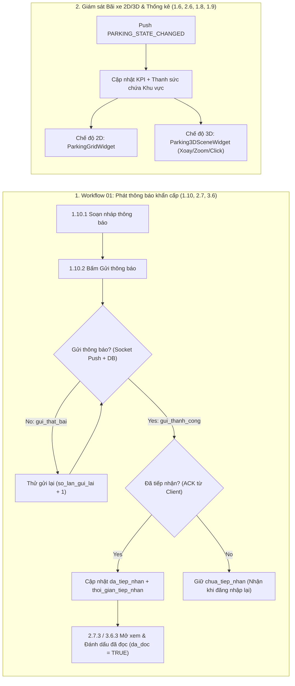

# Kế hoạch Triển khai Chi tiết — Thành viên 3: Minh (`feat/ui-notify-stats`)

Tài liệu này đặc tả toàn bộ thiết kế kỹ thuật, cấu trúc file và kế hoạch code **từng chức năng riêng lẻ** của **Thành viên 3 — Minh** trên nhánh `feat/ui-notify-stats`, bám sát 100% [Menu_Bai_xe_Dao_Tien_sieu_cap_V5.html](file:///D:/Lap_trinh_mang/Menu_Bai_xe_Dao_Tien_sieu_cap_V5.html), [csdl_workflow siu cấp.html](file:///D:/Lap_trinh_mang/csdl_workflow%20siu%20c%E1%BA%A5p.html) và bộ [DESIGN_SYSTEM.md](file:///D:/Lap_trinh_mang/smart_parking/DESIGN_SYSTEM.md).

> [!IMPORTANT]
> **Các quyết định thiết kế đã chốt cho phần của Minh:**
> 1. **Khung cửa sổ chính `MainWindow` dùng chung cho 4 vai trò:** Sidebar tối `#0B132B` (`256px` $\leftrightarrow$ thu gọn `72px`) + Topbar mảnh `56px` (hiển thị Tiêu đề, `RoleBadge`, chấm trạng thái Socket Online/Ping, nút Chuông thông báo kèm badge số tin chưa đọc) + `EmergencyBanner` ngay dưới Topbar.
> 2. **Chuẩn hóa 100% `Workflow 01` (Phát thông báo khẩn cấp) & Bảng 17–18:**
>    - Tách rõ `1.10.1 Soạn thông báo` (lưu nháp tạm trên RAM/App) và `1.10.2 Gửi thông báo` (`INSERT` vào `thong_bao` + `nguoi_nhan_thong_bao`, đẩy Socket Push real-time tới các tài khoản đang online, có nút **Thử gửi lại (Retry)** tăng `so_lan_gui_lai`).
>    - Tách biệt 2 trạng thái trên bảng `18. nguoi_nhan_thong_bao`: `trang_thai_tiep_nhan` (`chua_tiep_nhan` $\rightarrow$ `da_tiep_nhan` khi Client nhận Push hoặc bấm **"Xác nhận đã tiếp nhận"** trên `EmergencyDialog`/`EmergencyBanner`) và `da_doc` (`FALSE` $\rightarrow$ `TRUE` khi người dùng mở đọc chi tiết hoặc bấm **"Đánh dấu đã đọc"** ở `2.7.3` / `3.6.3`).
> 3. **Giám sát bãi xe (`1.6`, `2.6`, `4.5`) tích hợp chế độ `2D Grid` $\leftrightarrow$ `3D Sa bàn tương tác`:**
>    - Xây dựng `Parking3DSceneWidget` bằng `QPainter` 3D Projection thuần `PySide6` (mượt 60fps, không phụ thuộc driver OpenGL rời): vẽ mặt sàn bãi xe 3D, dựng khối xe Ô tô / Xe máy 3D có nhãn biển số trên các ô `dang_co_xe`, cọc giữ chỗ 3D cho ô `da_phan_cho`, rào chắn cho ô `ngung_su_dung`; hỗ trợ **kéo chuột xoay góc nhìn 3D (Yaw/Pitch), cuộn chuột Zoom và click vào khối ô/xe 3D để xem chi tiết**.
> 4. **Thống kê (`1.8`) & Lịch sử (`1.9`):** Kết hợp dữ liệu từ bảng `14. bao_cao_luot_va_thu_phi`, bảng `16. giao_dich_thanh_toan` và file `parking_history_YYYY-MM-DD.jsonl` (hiển thị kèm ảnh vào/ra đối chiếu).

---

## 1. Sơ đồ Luồng Nghiệp vụ của Minh (`Workflow 01` & Giám sát 2D/3D)

---

## 2. Proposed Changes (Danh sách File & Đặc tả Chức năng của Minh)

### Component 1: Khung Ứng dụng Chính & Sa bàn 3D (`client/main.py`, `client/ui/main_window.py`, `client/ui/theme/parking_3d_widget.py`)

#### [NEW] [parking_3d_widget.py](file:///D:/Lap_trinh_mang/smart_parking/client/ui/theme/parking_3d_widget.py)
Widget **Sa bàn Bãi giữ xe 3D tương tác (`Parking3DSceneWidget`)** dùng chung cho Quản lý (`1.6`), Nhân viên (`2.6`) và Admin (`4.5`):
- Sử dụng phép chiếu 3D (Isometric / Perspective camera với góc xoay ngang `yaw`, góc nghiêng `pitch`, hệ số `zoom` và độ lệch `pan_x`, `pan_y`) vẽ trực tiếp trên `QPainter` có khử răng cưa (`Antialiasing`).
- Hiển thị trực quan từng ô đỗ `vi_tri_do`:
  - `trong`: Mặt sàn ô đỗ màu xanh lá nhạt `#DCFCE7`, viền `#22C55E`, chữ mã vị trí nổi.
  - `da_phan_cho`: Mặt sàn xanh dương `#DBEAFE` kèm khối trụ giữ chỗ 3D màu `#2563EB`.
  - `dang_co_xe`: Vẽ **khối xe 3D** (thân xe + mui xe vát + kính + bánh xe) màu đỏ/xanh đậm kèm bảng biển số (`bien_so_xe`) lơ lửng phía trên nóc xe.
  - `ngung_su_dung`: Vẽ khối rào chắn bảo trì 3D sọc xám-cam.
- Tương tác chuột:
  - **Kéo chuột trái:** Xoay góc nhìn 3D (`yaw` 360°, `pitch` từ 20° đến 75°).
  - **Cuộn con lăn chuột:** Phóng to / thu nhỏ (`zoom` từ `0.6x` đến `2.2x`).
  - **Click chuột vào ô/xe 3D:** Phát `Signal` `slot_clicked(dict)` mở thông tin chi tiết ô đỗ, biển số, giờ vào và chủ xe.
  - Có nút **"Đặt lại góc nhìn 3D"** trên góc phải canvas.

#### [NEW] [main_window.py](file:///D:/Lap_trinh_mang/smart_parking/client/ui/main_window.py) & [main.py](file:///D:/Lap_trinh_mang/smart_parking/client/main.py)
Khung cửa sổ chính điều phối toàn bộ 4 vai trò:
- **Sidebar bên trái (`#Sidebar`):**
  - Tự động nạp danh mục chức năng theo `vai_tro` của phiên đăng nhập (`quan_ly` 10 nhóm, `nhan_vien` 7 nhóm, `cu_dan` 6 nhóm, `admin` 8 nhóm).
  - Nút thu gọn/mở rộng Sidebar (`256px` $\leftrightarrow$ `72px`).
- **Topbar (`#Topbar` - cao `56px`):**
  - Hiển thị tiêu đề màn hình đang mở, `RoleBadge(vai_tro)`, chấm trạng thái kết nối Socket (`Online · 12ms`), nút Chuông thông báo có số đếm chưa đọc và nút Đăng xuất.
- **Tích hợp lắng nghe `SocketClient.push_received`:**
  - Khi nhận `PushEvents.EMERGENCY_ALERT`: Tự động gửi ACK `da_tiep_nhan` (hoặc gửi khi người dùng bấm nút xác nhận), bật ngay `EmergencyDialog` nổi giữa màn hình đồng thời ghim `EmergencyBanner` đỏ ở đầu cửa sổ.
  - Khi nhận `PushEvents.NORMAL_NOTIFICATION`: Hiện `ToastNotification` góc phải dưới và tăng số đếm ở chuông Topbar.
  - Khi nhận `PushEvents.SESSION_REVOKED`: Hiện thông báo lý do tài khoản bị khóa/đặt lại mật khẩu và tự động quay về `LoginDialog`.

---

### Component 2: Hệ thống Thông báo & Cảnh báo Khẩn cấp — `Workflow 01` (`server/handlers/notify_handler.py`)

#### [NEW] [notify_handler.py](file:///D:/Lap_trinh_mang/smart_parking/server/handlers/notify_handler.py)
Cài đặt đầy đủ các chức năng riêng lẻ của mục **`1.10`** (Quản lý), **`2.7`** (Nhân viên) và **`3.6`** (Cư dân):

1. **Mục `1.10` Thông báo của Quản lý chung cư (3 chức năng riêng lẻ):**
   - **`1.10.1` — Soạn thông báo (`notify.save_draft`):**
     - Input: `tieu_de`, `noi_dung`, `loai_thong_bao` (`khan_cap`, `bao_tri_ky_thuat`, `ket_qua_duyet_ho_so`), `muc_do` (`binh_thuong`, `quan_trong`, `khan_cap`), `nhom_nguoi_nhan` (`tat_ca`, `cu_dan`, `nhan_vien`, `ca_nhan`), `ma_tai_khoan_ca_nhan` (tùy chọn).
     - Xử lý: Lưu bản nháp tạm trên RAM Server (hoặc chuyển thẳng sang bước phát hành trên UI) trả về `draft_id` để Quản lý kiểm tra lại nội dung trước khi phát.
   - **`1.10.2` — Gửi thông báo & Thử gửi lại (`notify.publish` & `notify.retry_failed`):**
     - Input: `draft_id` (hoặc dữ liệu thông báo) + `nhom_nguoi_nhan`.
     - Xử lý trong CSDL & Socket (khớp 100% **Workflow 01**):
       1. `INSERT INTO thong_bao` (`ma_nguoi_gui`, `tieu_de`, `noi_dung`, `loai_thong_bao`, `muc_do`, `nhom_nguoi_nhan`, `thoi_gian_gui`).
       2. Lấy danh sách `ma_tai_khoan` thuộc `nhom_nguoi_nhan` (đang `hoat_dong`).
       3. Đẩy gói `PUSH` (`EMERGENCY_ALERT` nếu `loai_thong_bao == 'khan_cap'` hoặc `muc_do == 'khan_cap'`, ngược lại là `NORMAL_NOTIFICATION`) qua `SessionManager`.
       4. Tạo các bản ghi trong bảng `18. nguoi_nhan_thong_bao`:
          - Nếu gửi lưu & đẩy thành công: `trang_thai_gui = 'gui_thanh_cong'`, `so_lan_gui_lai = 0`.
          - Nếu gặp lỗi kết nối/ghi (hoặc mô phỏng lỗi gửi): `trang_thai_gui = 'gui_that_bai'`.
          - Nếu tài khoản đang online và phản hồi ACK ngay: `trang_thai_tiep_nhan = 'da_tiep_nhan'`, `thoi_gian_tiep_nhan = NOW()`; nếu chưa xác nhận/đang offline: `trang_thai_tiep_nhan = 'chua_tiep_nhan'`, `da_doc = FALSE`.
       5. Nếu có người nhận rơi vào nhánh `No` (`gui_that_bai`) hoặc `chua_tiep_nhan`, Quản lý bấm **"Gửi lại thông báo"** (`notify.retry_failed`) $\rightarrow$ hệ thống tăng `so_lan_gui_lai = so_lan_gui_lai + 1`, đẩy lại gói `PUSH` và cập nhật `trang_thai_gui = 'gui_thanh_cong'`.
     - Output: Tổng số người nhận, số gửi thành công, số đã tiếp nhận, số chưa tiếp nhận.
   - **`1.10.3` — Xem thông báo đã gửi (`notify.list_sent`):**
     - Input: Khoảng ngày, `nhom_nguoi_nhan`, `loai_thong_bao`.
     - Output: Danh sách thông báo đã phát hành kèm thống kê chi tiết từ `nguoi_nhan_thong_bao` (Bao nhiêu người `gui_thanh_cong`, bao nhiêu `da_tiep_nhan`, bao nhiêu `da_doc`, số lần gửi lại).

2. **Mục `2.7` (Nhân viên) & `3.6` (Cư dân) Nhận và Đọc thông báo (6 chức năng riêng lẻ):**
   - **`2.7.1` & `3.6.1` — Xem danh sách thông báo (`notify.my_inbox`):**
     - Chỉ trả về các thông báo trong `nguoi_nhan_thong_bao` có `ma_tai_khoan_nhan == session.ma_tai_khoan`, sắp xếp thông báo `khan_cap` và chưa đọc lên đầu; đồng thời tự động cập nhật các bản ghi `chua_tiep_nhan` của tài khoản đó thành `da_tiep_nhan` (`thoi_gian_tiep_nhan = NOW()`).
   - **`2.7.2` & `3.6.2` — Xem nội dung thông báo (`notify.get_detail`):**
     - Trả về toàn bộ tiêu đề, nội dung, loại, mức độ, tên người gửi (`nhan_vien.ho_ten`) và thời gian gửi.
   - **`2.7.3` & `3.6.3` — Đánh dấu đã đọc & Xác nhận tiếp nhận (`notify.mark_read` & `notify.ack_emergency`):**
     - Cập nhật `da_doc = TRUE`, `trang_thai_tiep_nhan = 'da_tiep_nhan'`, `thoi_gian_tiep_nhan = COALESCE(thoi_gian_tiep_nhan, NOW())` trong bảng `nguoi_nhan_thong_bao`.

---

### Component 3: Giám sát Bãi xe 2D/3D, Thống kê Biểu đồ & Lịch sử Vào/Ra (`client/ui/manager/stats_history_view.py`, `client/ui/staff/staff_monitor_notify_view.py`, `client/ui/resident/resident_track_notify_view.py`)

#### [NEW] Handler Giám sát, Thống kê & Lịch sử (bổ sung vào `server/handlers/monitor_admin_handler.py`)
1. **Nhóm `1.6` (Quản lý) & `2.6` (Nhân viên) Giám sát bãi xe:**
   - **`1.6.1` — Xem xe đang gửi (`monitor.active_parkings`):** Kết hợp danh sách xe cư dân đang trong bãi (`quan_ly_phuong_tien_ra_vao.dang_trong_bai = TRUE` join `phuong_tien`, `cu_dan`) và danh sách xe khách vãng lai đang mở trong `StateStore` (`active_vang_lai.json`), lọc theo `ma_khu_vuc`, `bien_so_xe`.
   - **`1.6.2` — Xem chỗ trống (`monitor.available_slots`):** Lấy các ô `vi_tri_do` có `trang_thai_vi_tri = 'trong'` (hoặc `da_phan_cho` đang chưa có xe đỗ) theo `ma_khu_vuc`.
   - **`1.6.3` — Xem chỗ đang sử dụng (`monitor.occupied_slots`):** Lấy các ô `trang_thai_vi_tri = 'dang_co_xe'` kèm biển số xe đang đỗ.
   - **`1.6.4` & `2.6.1 / 2.6.2` — Xem tổng quan bãi & Sơ đồ trạng thái (`monitor.overview_map`):** Trả về số liệu từng `khu_vuc` (`tong_so_cho`, `so_xe_dang_gui`, số chỗ trống, ngừng sử dụng, thời gian cập nhật) + danh sách toàn bộ `vi_tri_do` gắn biển số hiện tại để render cả **2D Grid** lẫn **3D Sa bàn**.
2. **Nhóm `1.8` Thống kê (3 chức năng riêng lẻ):**
   - **`1.8.1` — Thống kê lượt xe (`stats.vehicle_turns`):** Tổng hợp số lượt xe vào và số lượt xe ra theo khoảng ngày và `ma_khu_vuc` từ `parking_history_*.jsonl` và `bao_cao_luot_va_thu_phi`.
   - **`1.8.2` — Thống kê xe cư dân và vãng lai (`stats.resident_vs_visitor`):** Tổng hợp và lập bảng so sánh `so_luot_xe_cu_dan` với (`so_luot_oto_vang_lai` + `so_luot_xemay_vang_lai`) theo khoảng thời gian và loại xe (`O_TO` / `XE_MAY`).
   - **`1.8.3` — Thống kê doanh thu (`stats.revenue`):** Tổng hợp tiền thực thu theo ngày hoặc theo tháng, tách rõ doanh thu phí tháng cư dân (`giao_dich_thanh_toan` có `trang_thai_giao_dich = 'thanh_toan_thanh_cong'`) và doanh thu khách vãng lai (`bao_cao_luot_va_thu_phi.tong_tien_thu_vang_lai`).
3. **Nhóm `1.9` Tra cứu lịch sử (3 chức năng riêng lẻ):**
   - **`1.9.1` — Xem lịch sử xe vào (`history.entries`):** Lọc từ `parking_history_*.jsonl` theo `bien_so_xe`, khoảng ngày $\rightarrow$ trả về thời điểm vào, ảnh vào (base64), vị trí, nhân viên xác nhận.
   - **`1.9.2` — Xem lịch sử xe ra (`history.exits`):** Lọc các lượt đã ra theo `bien_so_xe`, khoảng ngày $\rightarrow$ trả về thời điểm ra, số tiền thanh toán, nhân viên xác nhận.
   - **`1.9.3` — Xem chi tiết lượt gửi (`history.session_detail`):** Xem toàn bộ dữ liệu vào, ra, ảnh đối chiếu vào/ra, vị trí, phí và trạng thái theo `ma_luot_gui`.

#### [NEW] Các File Giao diện của Minh (`client/ui/`)
- [stats_history_view.py](file:///D:/Lap_trinh_mang/smart_parking/client/ui/manager/stats_history_view.py):
  - `ManagerMonitorView` (`1.6.1 – 1.6.4`): 4 thẻ `StatCard` + Thanh tiến độ sức chứa từng khu vực + Công tắc chuyển đổi **`[2D Lưới Ô Đỗ]` $\leftrightarrow$ `[3D Sa Bàn Tương Tác]`** + Bảng lọc Xe đang gửi / Chỗ trống / Chỗ đang dùng.
  - `ManagerStatsView` (`1.8.1 – 1.8.3`): Bộ lọc khoảng ngày/khu vực + Biểu đồ cột/đường nhúng bằng `Matplotlib FigureCanvasQTAgg` + Bảng đối chiếu chi tiết.
  - `ManagerHistoryView` (`1.9.1 – 1.9.3`): Bảng tra cứu lịch sử xe vào/ra + Dialog xem chi tiết lượt gửi kèm khung hiển thị 2 ảnh đối chiếu (Ảnh cổng vào & Ảnh cổng ra).
  - `ManagerNotifyView` (`1.10.1 – 1.10.3`): Form soạn nháp & phát thông báo (có preset nhanh cho sự cố **Cháy / Thiên tai / Mất điện / Bảo trì**) + Bảng theo dõi trạng thái gửi (`gui_thanh_cong` / `gui_that_bai`), trạng thái tiếp nhận (`da_tiep_nhan` / `chua_tiep_nhan`), trạng thái đọc (`da_doc`) và nút **Thử gửi lại (Retry)**.
- [staff_monitor_notify_view.py](file:///D:/Lap_trinh_mang/smart_parking/client/ui/staff/staff_monitor_notify_view.py): Màn hình Giám sát bãi xe 2D/3D (`2.6.1`, `2.6.2`) và Hộp thư Thông báo của Nhân viên (`2.7.1 – 2.7.3`).
- [resident_notify_view.py](file:///D:/Lap_trinh_mang/smart_parking/client/ui/resident/resident_notify_view.py): Hộp thư Thông báo của Cư dân (`3.6.1 – 3.6.3`).

---

## 3. Verification Plan (Kế hoạch Kiểm thử Phần của Minh)

### Automated Tests (`tests/test_minh_notify_stats_3d.py`)
1. **Test Luồng `Workflow 01` (Thông báo Khẩn cấp + Retry + ACK + Đã đọc):**
   - Lưu nháp (`1.10.1`) $\rightarrow$ Phát thông báo khẩn cấp (`1.10.2`) tới nhóm `tat_ca`.
   - Kiểm tra bản ghi `thong_bao` và `nguoi_nhan_thong_bao`: tài khoản đang kết nối Socket nhận ngay gói `PUSH` `EMERGENCY_ALERT`; tài khoản giả lập lỗi gửi có `trang_thai_gui = 'gui_that_bai'`.
   - Gọi `notify.retry_failed` $\rightarrow$ xác minh `so_lan_gui_lai` tăng lên `1` và chuyển sang `gui_thanh_cong`.
   - Gọi `notify.ack_emergency` $\rightarrow$ `trang_thai_tiep_nhan = 'da_tiep_nhan'` và `thoi_gian_tiep_nhan != NULL`.
   - Gọi `notify.mark_read` (`2.7.3` / `3.6.3`) $\rightarrow$ `da_doc = TRUE`.
2. **Test Khởi tạo & Phép chiếu `Parking3DSceneWidget`:**
   - Nạp danh sách 12 ô đỗ đủ 4 trạng thái (`trong`, `da_phan_cho`, `dang_co_xe`, `ngung_su_dung`) vào `Parking3DSceneWidget`, kiểm tra hàm tính tọa độ chiếu 3D và render sang `QImage` offscreen không phát sinh ngoại lệ.
3. **Test Thống kê (`1.8`) & Lịch sử (`1.9`):**
   - Kiểm tra tổng hợp lượt xe cư dân vs vãng lai, doanh thu theo ngày/tháng và lọc lịch sử vào/ra từ `parking_history_*.jsonl`.
