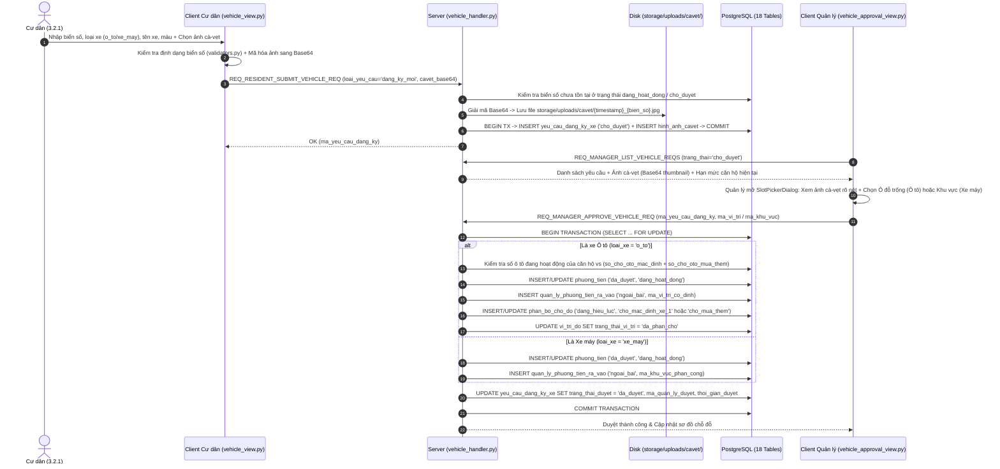

# Kế Hoạch Chi Tiết Thành Viên 4: Long (`feat/vehicle-slots`)
**Vai trò:** Resident Vehicle Lifecycle, Cavet Socket Upload & Fixed Slot / Extra Quota Allocation Engineer  
**Nhánh Git làm việc:** `feat/vehicle-slots`  
**Tổng số chức năng phụ trách:** **23 chức năng lá** (`1.4.1–1.4.4`, `1.4.15–1.4.19`, `3.2.1–3.2.5`, `3.3.1–3.3.5`, `3.4.1–3.4.4`)

---

## 1. Tổng Quan Trọng Trách & Ranh Giới Kiến Trúc

**Thành viên 4 (Long)** chịu trách nhiệm toàn bộ vòng đời đăng ký phương tiện cư dân, quản lý hạn mức chỗ đỗ ô tô của từng căn hộ (`so_cho_oto_mac_dinh` + `so_cho_oto_mua_them`), phân bổ ô đỗ cố định cho ô tô / khu vực đỗ cho xe máy, và giao diện tra cứu định vị xe dành cho Cư dân:

1. **Quản lý Phương tiện của Cư dân (`3.2.1–3.2.5`, `Workflow 02`):**
   - Xem danh sách xe đã đăng ký (`3.2.2`), theo dõi trạng thái hồ sơ (`3.2.3`), gửi yêu cầu đăng ký xe mới kèm **ảnh cà-vẹt truyền qua TCP Socket (Base64)** lưu vào `storage/uploads/cavet/` (`3.2.1`).
   - Gửi yêu cầu **Chỉnh sửa thông tin xe** (`3.2.4`, `loai_yeu_cau = 'chinh_sua_thong_tin'`) và **Ngừng đăng ký xe** (`3.2.5`, `loai_yeu_cau = 'ngung_dang_ky'`).
2. **Quản lý Duyệt Yêu cầu Phương tiện & Gán vị trí/khu vực đỗ (`1.4.1–1.4.4`, `Workflow 02` & `Workflow 05`):**
   - Xem danh sách yêu cầu chờ duyệt (`1.4.1`), xem ảnh cà-vẹt gốc (`hinh_anh_cavet`), kiểm tra biển số trùng và hạn mức ô tô của căn hộ.
   - **Duyệt yêu cầu (`1.4.2`):**
     - Với `dang_ky_moi` xe **Ô tô (`o_to`)**: Mở **Sơ đồ chọn ô đỗ trống trực quan** (`SlotPickerDialog`), tự động xác định `loai_phan_bo = 'cho_mac_dinh_xe_1'` (nếu là xe ô tô đầu tiên của căn hộ) hoặc `'cho_mua_them'` (nếu là xe ô tô thứ 2+ và căn hộ còn suất mua thêm), tạo bản ghi `phuong_tien`, `quan_ly_phuong_tien_ra_vao`, `phan_bo_cho_do`, và đổi `vi_tri_do.trang_thai_vi_tri = 'da_phan_cho'` trong **1 DB Transaction (ACID)**.
     - Với `dang_ky_moi` xe **Xe máy (`xe_may`)**: Chọn **Khu vực đỗ xe máy** (`ma_khu_vuc_phan_cong`), tạo bản ghi `phuong_tien` và `quan_ly_phuong_tien_ra_vao` (`ma_vi_tri_co_dinh = NULL`).
     - Với `chinh_sua_thong_tin`: Cập nhật thông tin `phuong_tien` và cập nhật ảnh cà-vẹt mới (nếu có).
     - Với `ngung_dang_ky`: Kiểm tra an toàn xe không đang đỗ trong bãi (`trang_thai_hien_tai != 'dang_do_trong_bai'`), chuyển `phuong_tien` sang `'ngung_hoat_dong'`, thu hồi phân bổ chỗ đỗ và giải phóng ô đỗ.
   - **Từ chối yêu cầu (`1.4.3`)** kèm lý do bắt buộc (`ly_do_tu_choi`) và **Xem lịch sử duyệt (`1.4.4`)**.
3. **Mua thêm chỗ đỗ Ô tô (`3.3.1–3.3.5`) & Quản lý Duyệt / Thu hồi chỗ (`1.4.15–1.4.19`):**
   - Cư dân gửi yêu cầu mua thêm chỗ đỗ cho ô tô thứ 2 trở đi (`3.3.1`), xem trạng thái (`3.3.2`), danh sách chỗ mua thêm (`3.3.3`), vị trí được cấp (`3.3.4`), và lịch sử yêu cầu (`3.3.5`).
   - Quản lý xem danh sách chờ duyệt (`1.4.15`), duyệt & chọn ô đỗ ô tô trống trên sơ đồ (`1.4.16` $\rightarrow$ tăng `can_ho.so_cho_oto_mua_them += 1`, tạo `phan_bo_cho_do` loại `'cho_mua_them'`, đổi `vi_tri_do` sang `'da_phan_cho'`), từ chối (`1.4.17`), xem danh sách căn hộ đã mua thêm chỗ (`1.4.18`), và **Thu hồi chỗ đỗ đã cấp (`1.4.19`)** với kiểm tra an toàn `trang_thai_vi_tri != 'dang_co_xe'`.
4. **Tra cứu & Định vị xe của Cư dân (`3.4.1–3.4.4`):**
   - Hiển thị hệ thống **Vehicle Status Cards** trực quan (`3.4.1–3.4.4`), tích hợp nút **"Định vị trên Sơ đồ bãi xe"** mở Mini-Map 2D/3D làm sáng nhấp nháy đúng ô đỗ cố định/hiện tại hoặc khu vực đỗ của xe, xem ảnh cà-vẹt phóng to và 10 lượt vào/ra gần nhất trích từ `parking_history_*.jsonl`.

> [!IMPORTANT]
> **Ràng buộc tương thích 100% với Bảng dữ liệu & Thành viên khác:**
> - Tuân thủ tuyệt đối cấu trúc 6 bảng liên quan trực tiếp trong [csdl_workflow siu cấp.html](file:///d:/Lap_trinh_mang/csdl_workflow%20siu%20c%E1%BA%A5p.html): `can_ho`, `phuong_tien`, `yeu_cau_dang_ky_xe`, `hinh_anh_cavet`, `quan_ly_phuong_tien_ra_vao`, `yeu_cau_mua_them_cho`, `phan_bo_cho_do`, `vi_tri_do`, `khu_vuc_do`.
> - Cung cấp hỗ trợ chế độ `read_only=True` kèm `ReadOnlyBanner` trên `VehicleApprovalView` (`1.4.1–1.4.4`, `1.4.15–1.4.19`) để **Leader Biên** tái sử dụng cho mục Admin `4.6 Xem thông tin phương tiện và chỗ đỗ`.
> - Mọi thao tác Duyệt/Từ chối/Thu hồi của Quản lý đều có thể bắn thông báo hệ thống hoặc ghi `file_logger.log_audit(...)` để lưu vết đầy đủ.

---

## 2. Danh Sách File Thành Viên 4 (Long) Phụ Trách

```text
smart_parking/
├── server/
│   └── handlers/
│       └── vehicle_handler.py                # [Long] Xử lý 1.4.1-1.4.4, 1.4.15-1.4.19, 3.2.1-3.2.5, 3.3.1-3.3.5, 3.4.1-3.4.4
│
├── client/
│   └── ui/
│       ├── manager/
│       │   ├── vehicle_approval_view.py      # [Long] 1.4.1-1.4.4 (Duyệt xe + Sơ đồ gán ô đỗ) & 1.4.15-1.4.19 (Duyệt/Thu hồi mua thêm chỗ)
│       │   └── slot_picker_dialog.py         # [Long] Dialog chọn trực quan Ô đỗ Ô tô trống / Khu vực Xe máy + Xem ảnh cà-vẹt phóng to
│       └── resident/
│           ├── vehicle_view.py               # [Long] 3.2.1-3.2.5 (Đăng ký xe mới + Upload ảnh cà-vẹt, Sửa thông tin, Ngừng đăng ký)
│           ├── extra_slot_view.py            # [Long] 3.3.1-3.3.5 (Yêu cầu mua thêm chỗ đỗ ô tô, trạng thái, vị trí được cấp & lịch sử)
│           └── vehicle_lookup_view.py        # [Long] 3.4.1-3.4.4 (Vehicle Status Cards + Mini-Map 2D/3D định vị xe + Lịch sử 10 lượt vào/ra)
│
└── tests/
    └── test_vehicle_slots.py                 # [Long] Unit/Integration test cho Workflow 02, Workflow 05, Mua thêm & Thu hồi chỗ đỗ
```

---

## 3. Thiết Kế Luồng Nghiệp Vụ & Sơ Đồ Tuần Tự (`Workflow 02`, `Workflow 05` & Extra Slot)

### 3.1. Sơ đồ `Workflow 02` & `Workflow 05` (Đăng ký xe Cư dân $\rightarrow$ Upload Cà-vẹt $\rightarrow$ Quản lý Duyệt & Gán chỗ đỗ)



---

## 4. Đặc Tả Chi Tiết Từng File & Từng Chức Năng (`23 Chức Năng Lá`)

### 4.1. `server/handlers/vehicle_handler.py` — Backend Nghiệp Vụ Phương Tiện & Phân Bổ Chỗ Đỗ

#### A. Nhóm Action cho Cư dân: Quản lý Phương tiện (`3.2.1–3.2.5`)

1. **`REQ_RESIDENT_GET_VEHICLES_AND_REQS` (`3.2.2`, `3.2.3`)**:
   - **Input:** `ma_cu_dan` (lấy tự động từ `session` của Cư dân đang đăng nhập để chống giả mạo căn hộ khác).
   - **Xử lý SQL:**
     - Lấy thông tin căn hộ của cư dân (`can_ho`: `ma_can_ho`, `so_can_ho`, `toa_nha`, `tang`, `so_cho_oto_mac_dinh`, `so_cho_oto_mua_them`) và đếm số ô tô đang hoạt động (`so_oto_hien_tai`), số xe máy đang hoạt động (`so_xe_may_hien_tai`).
     - Truy vấn danh sách xe trong bảng `phuong_tien` (`3.2.2`) JOIN `quan_ly_phuong_tien_ra_vao`, `vi_tri_do`, `khu_vuc_do` và ảnh cà-vẹt mới nhất từ `hinh_anh_cavet`.
     - Truy vấn danh sách yêu cầu trong bảng `yeu_cau_dang_ky_xe` (`3.2.3`) JOIN `hinh_anh_cavet` và `quan_ly` (người duyệt) sắp xếp theo `thoi_gian_gui DESC`.

2. **`REQ_RESIDENT_SUBMIT_VEHICLE_REQ` (`3.2.1`, `3.2.4`, `3.2.5` — `Workflow 02`)**:
   - **Input:**
     - `loai_yeu_cau`: `'dang_ky_moi'` (`3.2.1`), `'chinh_sua_thong_tin'` (`3.2.4`), hoặc `'ngung_dang_ky'` (`3.2.5`).
     - `ma_phuong_tien`: `NULL` nếu là `'dang_ky_moi'`, bắt buộc có nếu là `'chinh_sua_thong_tin'` hoặc `'ngung_dang_ky'`.
     - `loai_xe` (`'o_to'` | `'xe_may'`), `bien_so`, `ten_xe`, `mau_xe`, `ghi_chu`.
     - `cavet_image_base64`, `cavet_filename` (bắt buộc khi `'dang_ky_moi'`; tùy chọn khi `'chinh_sua_thong_tin'`).
   - **Kiểm tra hợp lệ & Nghiệp vụ:**
     - Chuẩn hóa biển số qua `validators.validate_license_plate(bien_so, loai_xe)`.
     - Nếu `loai_yeu_cau == 'dang_ky_moi'`:
       - Kiểm tra `bien_so` chưa tồn tại trong `phuong_tien` (với `trang_thai_hoat_dong = 'dang_hoat_dong'`) và chưa có yêu cầu `'cho_duyet'` nào trùng biển số.
       - Kiểm tra hạn mức ô tô của căn hộ: Nếu `loai_xe == 'o_to'` và số xe ô tô đang hoạt động + số yêu cầu đăng ký ô tô đang chờ duyệt $\ge$ (`so_cho_oto_mac_dinh + so_cho_oto_mua_them`) và căn hộ chưa có suất mua thêm chỗ nào đang chờ gán xe, trả cảnh báo rõ ràng hướng dẫn cư dân gửi kèm hoặc hoàn tất **Yêu cầu mua thêm chỗ đỗ ô tô (`3.3.1`)**.
       - Giải mã `cavet_image_base64` (giới hạn dung lượng ảnh $\le 5\text{ MB}$, định dạng `.jpg/.jpeg/.png`), lưu xuống `storage/uploads/cavet/cavet_{ma_cu_dan}_{bien_so}_{timestamp}.jpg`.
     - Nếu `loai_yeu_cau in ('chinh_sua_thong_tin', 'ngung_dang_ky')`:
       - Xác thực `ma_phuong_tien` thuộc đúng `ma_cu_dan` đang đăng nhập và chưa có yêu cầu `'cho_duyet'` nào đang treo cho xe đó.
       - Nếu là `'ngung_dang_ky'` và xe đang ở trong bãi (`trang_thai_hien_tai == 'dang_do_trong_bai'`), chặn ngay từ bước gửi yêu cầu (hoặc cảnh báo cư dân phải lấy xe ra khỏi bãi trước khi hủy đăng ký).
     - Thực thi `INSERT INTO yeu_cau_dang_ky_xe (...) RETURNING ma_yeu_cau_dang_ky` và (nếu có ảnh) `INSERT INTO hinh_anh_cavet (ma_yeu_cau_dang_ky, ma_phuong_tien, duong_dan_file, ten_file_goc)`.

3. **`REQ_GET_CAVET_IMAGE` (Tải ảnh cà-vẹt độ phân giải gốc qua Socket)**:
   - **Input:** `ma_hinh_anh` hoặc `duong_dan_file`.
   - **Xử lý:** Kiểm tra quyền truy cập (Quản lý, Admin hoặc chính Cư dân chủ xe), đọc file từ `storage/uploads/cavet/...`, mã hóa Base64 và trả về để Client mở hộp thoại xem ảnh phóng to (`ZoomableImageDialog`).

---

#### B. Nhóm Action cho Quản lý: Duyệt Phương tiện & Gán Chỗ đỗ (`1.4.1–1.4.4` — `Workflow 02` & `Workflow 05`)

1. **`REQ_MANAGER_LIST_VEHICLE_REQS` (`1.4.1`, `1.4.4`)**:
   - **Input:** Bộ lọc `trang_thai_duyet` (`'cho_duyet'` cho `1.4.1`, hoặc `'da_duyet' / 'tu_choi' / 'all'` cho Lịch sử `1.4.4`), `loai_yeu_cau`, `loai_xe`, `search_query` (biển số, tên cư dân, mã căn hộ).
   - **Output:** Danh sách yêu cầu kèm thông tin cư dân (`ho_ten`, `so_dien_thoai`), căn hộ (`so_can_ho`, `toa_nha`, `so_cho_oto_mac_dinh`, `so_cho_oto_mua_them`, `so_oto_hien_tai`), danh sách `hinh_anh_cavet`, và thông tin suất chỗ đỗ mua thêm chưa gắn xe (nếu có) của căn hộ đó.

2. **`REQ_MANAGER_GET_ASSIGNABLE_SLOTS_AND_ZONES` (Dữ liệu cho `SlotPickerDialog` khi duyệt `1.4.2`)**:
   - **Input:** `ma_can_ho`, `loai_xe`.
   - **Output:**
     - Nếu `loai_xe == 'xe_may'`: Danh sách các khu vực xe máy (`khu_vuc_do` có `loai_xe_ap_dung = 'xe_may'` và `trang_thai_khu_vuc = 'hoat_dong'`) kèm `so_cho_trong` hiện tại.
     - Nếu `loai_xe == 'o_to'`:
       1. Các bản ghi `phan_bo_cho_do` của căn hộ đang ở trạng thái `'dang_hieu_luc'` nhưng `ma_phuong_tien IS NULL` (tức căn hộ đã được duyệt mua thêm chỗ đỗ trước đó ở mục `1.4.16` và đã có sẵn ô đỗ dành riêng chờ gắn xe).
       2. Toàn bộ sơ đồ các khu vực ô tô (`loai_xe_ap_dung = 'o_to'`) và danh sách `vi_tri_do` (`trang_thai_vi_tri = 'trong'`) để Quản lý click chọn trực quan trên sơ đồ 2D.

3. **`REQ_MANAGER_APPROVE_VEHICLE_REQ` (`1.4.2` — `Workflow 02` & `Workflow 05`)**:
   - **Input:** `ma_yeu_cau_dang_ky`, `ma_vi_tri_co_dinh` (bắt buộc nếu duyệt đăng ký mới `o_to`), `ma_khu_vuc_phan_cong` (bắt buộc nếu duyệt đăng ký mới `xe_may`).
   - **Transaction ACID (`with db.transaction() as cur:`):**
     - `SELECT * FROM yeu_cau_dang_ky_xe WHERE ma_yeu_cau_dang_ky = %s FOR UPDATE`. Đảm bảo `trang_thai_duyet == 'cho_duyet'`.
     - **Trường hợp 1: `loai_yeu_cau == 'dang_ky_moi'`:**
       - Kiểm tra lại biển số chưa bị trùng trong `phuong_tien` (`dang_hoat_dong`).
       - **Nếu `loai_xe == 'o_to'`:**
         - Khóa dòng căn hộ `SELECT * FROM can_ho WHERE ma_can_ho = %s FOR UPDATE`.
         - Đếm số xe ô tô đang hoạt động của căn hộ (`active_cars`). Tổng hạn mức = `so_cho_oto_mac_dinh + so_cho_oto_mua_them`.
         - Nếu `active_cars >= tong_han_muc`: Raise lỗi nghiệp vụ `"Căn hộ đã hết hạn mức chỗ đỗ ô tô. Vui lòng duyệt yêu cầu mua thêm chỗ đỗ trước."`
         - Xác định `loai_phan_bo`: Nếu căn hộ chưa có phân bổ `'cho_mac_dinh_xe_1'` đang hiệu lực $\rightarrow$ `'cho_mac_dinh_xe_1'`; ngược lại $\rightarrow$ `'cho_mua_them'`.
         - Tạo dòng mới trong `phuong_tien` (`trang_thai_dang_ky = 'da_duyet'`, `trang_thai_hoat_dong = 'dang_hoat_dong'`, `ngay_dang_ky = NOW()`).
         - Cập nhật `hinh_anh_cavet SET ma_phuong_tien = new_ma_phuong_tien WHERE ma_yeu_cau_dang_ky = %s`.
         - Kiểm tra xem `ma_vi_tri_co_dinh` thuộc về một `phan_bo_cho_do` mua thêm đã cấp sẵn cho căn hộ (`ma_phuong_tien IS NULL`) hay là một ô đỗ đang `'trong'`:
           - Nếu là ô đã cấp sẵn cho căn hộ: `UPDATE phan_bo_cho_do SET ma_phuong_tien = new_ma_phuong_tien WHERE ma_phan_bo = ...`
           - Nếu là ô đang `'trong'`: Khóa dòng `vi_tri_do FOR UPDATE`, kiểm tra `trang_thai_vi_tri == 'trong'`, `INSERT INTO phan_bo_cho_do (ma_can_ho, ma_phuong_tien, ma_vi_tri, loai_phan_bo, trang_thai_phan_bo, ngay_bat_dau) VALUES (..., 'dang_hieu_luc', CURRENT_DATE)` và `UPDATE vi_tri_do SET trang_thai_vi_tri = 'da_phan_cho'`.
         - `INSERT INTO quan_ly_phuong_tien_ra_vao (ma_phuong_tien, trang_thai_hien_tai, ma_vi_tri_co_dinh, ma_khu_vuc_phan_cong) VALUES (new_ma_phuong_tien, 'ngoai_bai', ma_vi_tri_co_dinh, ma_khu_vuc_cua_vi_tri)`.
       - **Nếu `loai_xe == 'xe_may'`:**
         - Kiểm tra `ma_khu_vuc_phan_cong` thuộc khu vực `'xe_may'` đang `'hoat_dong'`.
         - `INSERT INTO phuong_tien (...) RETURNING ma_phuong_tien`.
         - Cập nhật `hinh_anh_cavet SET ma_phuong_tien = new_ma_phuong_tien`.
         - `INSERT INTO quan_ly_phuong_tien_ra_vao (ma_phuong_tien, trang_thai_hien_tai, ma_khu_vuc_phan_cong) VALUES (new_ma_phuong_tien, 'ngoai_bai', ma_khu_vuc_phan_cong)`.
     - **Trường hợp 2: `loai_yeu_cau == 'chinh_sua_thong_tin'`:**
       - `UPDATE phuong_tien SET bien_so = %s, ten_xe = %s, mau_xe = %s WHERE ma_phuong_tien = %s`.
       - Nếu yêu cầu có đính kèm ảnh cà-vẹt mới, gắn `ma_phuong_tien` cho bản ghi `hinh_anh_cavet` mới đó.
     - **Trường hợp 3: `loai_yeu_cau == 'ngung_dang_ky'`:**
       - Kiểm tra `quan_ly_phuong_tien_ra_vao.trang_thai_hien_tai`: Nếu `'dang_do_trong_bai'`, chặn duyệt và báo lỗi `"Xe đang đỗ trong bãi, không thể duyệt ngừng đăng ký!"`.
       - `UPDATE phuong_tien SET trang_thai_hoat_dong = 'ngung_hoat_dong' WHERE ma_phuong_tien = %s`.
       - Nếu là xe ô tô có phân bổ chỗ đỗ (`phan_bo_cho_do` đang `'dang_hieu_luc'`):
         - Nếu `loai_phan_bo == 'cho_mac_dinh_xe_1'`: `UPDATE phan_bo_cho_do SET trang_thai_phan_bo = 'da_thu_hoi', ngay_ket_thuc = CURRENT_DATE`, và trả `vi_tri_do.trang_thai_vi_tri = 'trong'`.
         - Nếu `loai_phan_bo == 'cho_mua_them'`: Giữ suất mua thêm cho căn hộ bằng cách gỡ `ma_phuong_tien = NULL` trên `phan_bo_cho_do` (hoặc nếu cư dân muốn trả luôn chỗ mua thêm thì thu hồi ở `1.4.19`), đồng thời xóa `ma_vi_tri_co_dinh = NULL` trong `quan_ly_phuong_tien_ra_vao`.
     - Cuối cùng: `UPDATE yeu_cau_dang_ky_xe SET trang_thai_duyet = 'da_duyet', ma_quan_ly_duyet = %s, thoi_gian_duyet = NOW()`.
     - Ghi `file_logger.log_audit(...)`.

4. **`REQ_MANAGER_REJECT_VEHICLE_REQ` (`1.4.3`)**:
   - **Input:** `ma_yeu_cau_dang_ky`, `ly_do_tu_choi` (bắt buộc không rỗng).
   - **Xử lý:** `UPDATE yeu_cau_dang_ky_xe SET trang_thai_duyet = 'tu_choi', ma_quan_ly_duyet = %s, thoi_gian_duyet = NOW(), ly_do_tu_choi = %s WHERE ma_yeu_cau_dang_ky = %s AND trang_thai_duyet = 'cho_duyet'`. Ghi Audit Log.

---

#### C. Nhóm Action Mua thêm & Thu hồi Chỗ đỗ Ô tô (`3.3.1–3.3.5` & `1.4.15–1.4.19`)

1. **`REQ_RESIDENT_GET_EXTRA_SLOTS_DATA` (`3.3.2`, `3.3.3`, `3.3.4`, `3.3.5`)**:
   - **Input:** `ma_cu_dan` (từ session).
   - **Output:**
     - Thông tin hạn mức căn hộ (`so_cho_oto_mac_dinh`, `so_cho_oto_mua_them`, tổng số chỗ, số chỗ đang gắn xe).
     - Danh sách các chỗ đỗ đã được phân bổ cho căn hộ (`phan_bo_cho_do` JOIN `vi_tri_do`, `khu_vuc_do`, `phuong_tien`) để hiển thị mục `3.3.3 Xem danh sách chỗ đỗ đã mua thêm` và `3.3.4 Xem vị trí đỗ đã được cấp`.
     - Danh sách toàn bộ yêu cầu trong `yeu_cau_mua_them_cho` của cư dân để hiển thị mục `3.3.2 Trạng thái yêu cầu đang chờ` và `3.3.5 Lịch sử yêu cầu mua thêm chỗ đỗ`.

2. **`REQ_RESIDENT_SUBMIT_EXTRA_SLOT_REQ` (`3.3.1`)**:
   - **Input:** `so_luong_cho_muon_mua` (mặc định `1`), `ma_phuong_tien` (tùy chọn — có thể chọn xe ô tô của căn hộ hoặc để `NULL` nếu mua suất chỗ trước khi đăng ký xe), `ly_do_yeu_cau`.
   - **Xử lý:** Kiểm tra cư dân không có yêu cầu mua thêm chỗ nào đang `'cho_duyet'` bị trùng lắp, thực thi `INSERT INTO yeu_cau_mua_them_cho (ma_can_ho, ma_cu_dan, ma_phuong_tien, so_luong_cho_muon_mua, ly_do_yeu_cau, trang_thai_duyet) VALUES (..., 'cho_duyet')`.

3. **`REQ_MANAGER_LIST_EXTRA_SLOT_REQS` (`1.4.15`, `1.4.18`)**:
   - **Input:** Bộ lọc `trang_thai_duyet` (`'cho_duyet'` cho `1.4.15`), tìm kiếm theo căn hộ / cư dân.
   - **Output:**
     - Danh sách `yeu_cau_mua_them_cho` JOIN `can_ho`, `cu_dan`, `phuong_tien`, `quan_ly`.
     - Danh sách các căn hộ đang có chỗ đỗ mua thêm (`1.4.18 Xem danh sách căn hộ đã mua thêm chỗ` — truy vấn từ `phan_bo_cho_do WHERE loai_phan_bo = 'cho_mua_them' AND trang_thai_phan_bo = 'dang_hieu_luc'` JOIN `can_ho`, `vi_tri_do`, `khu_vuc_do`, `phuong_tien`).

4. **`REQ_MANAGER_APPROVE_EXTRA_SLOT_REQ` (`1.4.16`)**:
   - **Input:** `ma_yeu_cau_mua_cho`, `danh_sach_ma_vi_tri` (danh sách mã ô đỗ ô tô đang `'trong'` được Quản lý chọn trên `SlotPickerDialog`, số lượng khớp với `so_luong_cho_muon_mua`).
   - **Transaction ACID:**
     - Khóa `yeu_cau_mua_them_cho` (`FOR UPDATE`), kiểm tra `trang_thai_duyet == 'cho_duyet'`.
     - Khóa các dòng `vi_tri_do` được chọn (`FOR UPDATE`), kiểm tra tất cả đều thuộc khu vực `'o_to'` và có `trang_thai_vi_tri == 'trong'`.
     - Với mỗi `ma_vi_tri`:
       - Tạo bản ghi `phan_bo_cho_do` (`ma_can_ho`, `ma_phuong_tien` nếu yêu cầu có đính kèm xe chưa có chỗ, `ma_vi_tri`, `loai_phan_bo = 'cho_mua_them'`, `trang_thai_phan_bo = 'dang_hieu_luc'`, `ngay_bat_dau = CURRENT_DATE`).
       - Cập nhật `vi_tri_do SET trang_thai_vi_tri = 'da_phan_cho'`.
       - Nếu yêu cầu có gắn `ma_phuong_tien`, cập nhật `quan_ly_phuong_tien_ra_vao SET ma_vi_tri_co_dinh = ma_vi_tri, ma_khu_vuc_phan_cong = ma_khu_vuc`.
     - Cập nhật `can_ho SET so_cho_oto_mua_them = so_cho_oto_mua_them + so_luong_cho_muon_mua`.
     - Cập nhật `yeu_cau_mua_them_cho SET trang_thai_duyet = 'da_duyet', ma_quan_ly_duyet = %s, thoi_gian_duyet = NOW()`.
     - Ghi Audit Log.

5. **`REQ_MANAGER_REJECT_EXTRA_SLOT_REQ` (`1.4.17`)**:
   - **Input:** `ma_yeu_cau_mua_cho`, `ghi_chu_tu_choi` (lưu vào `ly_do_yeu_cau` hoặc trường ghi chú/log).
   - **Xử lý:** `UPDATE yeu_cau_mua_them_cho SET trang_thai_duyet = 'tu_choi', ma_quan_ly_duyet = %s, thoi_gian_duyet = NOW()`.

6. **`REQ_MANAGER_REVOKE_EXTRA_SLOT` (`1.4.19 Thu hồi chỗ đỗ đã cấp`)**:
   - **Input:** `ma_phan_bo`, `ly_do_thu_hoi`.
   - **Transaction ACID & Kiểm tra an toàn:**
     - Khóa dòng `phan_bo_cho_do` và `vi_tri_do` (`FOR UPDATE`).
     - **Kiểm tra an toàn:** Nếu `vi_tri_do.trang_thai_vi_tri == 'dang_co_xe'` (hoặc xe gắn với chỗ đỗ đó đang có `trang_thai_hien_tai == 'dang_do_trong_bai'`), **chặn thu hồi ngay lập tức** và trả thông báo lỗi: `"Ô đỗ đang có xe đỗ bên trong, không thể thu hồi cho đến khi xe rời bãi!"`.
     - Cập nhật `phan_bo_cho_do SET trang_thai_phan_bo = 'da_thu_hoi', ngay_ket_thuc = CURRENT_DATE`.
     - Cập nhật `vi_tri_do SET trang_thai_vi_tri = 'trong'`.
     - Nếu `loai_phan_bo == 'cho_mua_them'`: Cập nhật `can_ho SET so_cho_oto_mua_them = GREATEST(0, so_cho_oto_mua_them - 1)`.
     - Nếu `ma_phuong_tien IS NOT NULL`: Gỡ `ma_vi_tri_co_dinh = NULL` trong `quan_ly_phuong_tien_ra_vao` (và chuyển `phuong_tien.trang_thai_hoat_dong = 'ngung_hoat_dong'` nếu xe ô tô thứ 2+ không còn suất đỗ hợp lệ).
     - Ghi `file_logger.log_audit(...)`.

---

#### D. Nhóm Action Tra cứu & Định vị Xe của Cư dân (`3.4.1–3.4.4`)

1. **`REQ_RESIDENT_LOOKUP_VEHICLES` (`3.4.1–3.4.4`)**:
   - **Input:** `ma_cu_dan` (từ session).
   - **Output tổng hợp cho từng xe của cư dân:**
     - Thông tin cơ bản & trạng thái đăng ký (`3.4.4`): `ma_phuong_tien`, `bien_so`, `loai_xe`, `ten_xe`, `mau_xe`, `trang_thai_dang_ky`, `trang_thai_hoat_dong`, `duong_dan_file` cà-vẹt.
     - Trạng thái hiện tại trong bãi hay ngoài bãi (`3.4.1`): `quan_ly_phuong_tien_ra_vao.trang_thai_hien_tai` (`'dang_do_trong_bai'` | `'ngoai_bai'`).
     - Vị trí đỗ cố định / vị trí hiện tại / khu vực được phân công (`3.4.2`): `ma_vi_tri_co_dinh`, `ma_vi_tri_hien_tai`, `ma_khu_vuc_phan_cong`, kèm chi tiết `ma_vi_tri_code` (VD: `A1-05`), `ten_khu_vuc`, `loai_phan_bo`.
     - Thời gian vào/ra bãi gần nhất (`3.4.3`): `thoi_gian_vao_gan_nhat`, `thoi_gian_ra_gan_nhat`.
     - **10 lượt vào/ra gần nhất của biển số đó:** Đọc nhanh từ `file_logger.query_logs("parking_history", filter_fn=lambda r: r.get("bien_so") == bien_so, limit=10)`.
     - **Dữ liệu Mini-Map của khu vực đỗ:** Danh sách các ô đỗ (`vi_tri_do`) trong khu vực của xe đó để Client vẽ Mini-Map 2D/3D và làm sáng nhấp nháy đúng vị trí của xe.

---

### 4.2. Thiết Kế Chi Tiết Giao Diện PySide6 (`client/ui/...`)

#### A. `client/ui/manager/slot_picker_dialog.py` — Hộp Thoại Chọn Ô Đỗ Trực Quan & Xem Ảnh Cà-vẹt
- **Chức năng kép:**
  1. **`CavetPreviewWidget`**: Hiển thị ảnh cà-vẹt sắc nét với thanh công cụ Phóng to (`+`), Thu nhỏ (`-`), Xoay ảnh (`90°`) để Quản lý đối chiếu chính xác Biển số, Tên chủ xe, Nhãn hiệu và Màu sơn trên giấy đăng ký xe với dữ liệu cư dân nhập.
  2. **`InteractiveSlotPicker`**:
     - Nếu duyệt **Ô tô (`o_to`)**: Hiển thị sơ đồ lưới các ô đỗ của khu vực ô tô:
       - Ô màu **Xanh lá nhạt (`#DCFCE7`)**: Ô đang `'trong'` (click để chọn gán cho xe/căn hộ).
       - Ô màu **Xanh dương (`#DBEAFE`)**: Suất mua thêm đã cấp sẵn cho căn hộ này nhưng chưa gắn xe (ưu tiên gợi ý đầu tiên).
       - Ô màu **Xám / Đỏ / Vàng**: Đã phân cho căn hộ khác, đang có xe, hoặc đang bảo trì (vô hiệu hóa click).
     - Nếu duyệt **Xe máy (`xe_may`)**: Hiển thị danh sách thẻ Khu vực xe máy (`Khu Xe Máy Tầng B1`, v.v.) kèm thanh tiến trình sức chứa để chọn `ma_khu_vuc_phan_cong`.

#### B. `client/ui/manager/vehicle_approval_view.py` — Màn Hình Quản Lý Duyệt Phương Tiện & Mua Thêm Chỗ (`1.4.1–1.4.4`, `1.4.15–1.4.19`)
- **Hỗ trợ tham số `read_only: bool = False`:** Khi Admin mở ở mục `4.6`, hiển thị `ReadOnlyBanner` ở đầu trang và ẩn/khóa các nút Duyệt, Từ chối, Thu hồi.
- **Bố cục 2 Tab chính:**
  - **Tab 1: Duyệt Đăng ký & Biến động Phương tiện (`1.4.1–1.4.4`)**:
    - Thanh công cụ lọc: Chờ duyệt (`1.4.1`) | Lịch sử Đã duyệt / Từ chối (`1.4.4`) | Lọc theo Loại yêu cầu (`Đăng ký mới` / `Chỉnh sửa` / `Ngừng đăng ký`) | Lọc theo Loại xe (`Ô tô` / `Xe máy`).
    - Bảng danh sách yêu cầu + Panel chi tiết bên phải (`380px`): Hiển thị thông tin Cư dân, Hạn mức ô tô căn hộ (`Đang dùng: 1/2 chỗ`), Ảnh cà-vẹt thu nhỏ (bấm vào để phóng to), Nút **"Duyệt & Gán chỗ đỗ" (`1.4.2`)** và Nút **"Từ chối" (`1.4.3`)**.
  - **Tab 2: Duyệt Mua thêm & Thu hồi Chỗ đỗ Ô tô (`1.4.15–1.4.19`)**:
    - Sub-tab 2A: **Yêu cầu mua thêm chỗ chờ duyệt (`1.4.15–1.4.17`)** — Bấm **"Duyệt & Cấp ô đỗ" (`1.4.16`)** sẽ mở `SlotPickerDialog` để chọn ô đỗ ô tô trống; bấm **"Từ chối" (`1.4.17`)** nhập lý do từ chối.
    - Sub-tab 2B: **Danh sách căn hộ đã cấp chỗ & Thu hồi (`1.4.18–1.4.19`)** — Hiển thị toàn bộ bản ghi `phan_bo_cho_do` đang hiệu lực kèm trạng thái ô đỗ thực tế (`trong` / `da_phan_cho` / `dang_co_xe`) và nút **"Thu hồi chỗ đỗ" (`1.4.19`)** (tự động disable kèm tooltip giải thích nếu ô đang có xe đỗ).

#### C. `client/ui/resident/vehicle_view.py` — Màn Hình Quản Lý Xe Của Cư Dân (`3.2.1–3.2.5`)
- **Header Quota Summary:** Hiển thị thẻ tóm tắt hạn mức của căn hộ:
  - `Suất Ô tô mặc định: 1` | `Suất Ô tô mua thêm: X` | `Số Ô tô đang hoạt động: Y` | `Số Xe máy đang hoạt động: Z`.
- **Khu vực Danh sách Phương tiện (`3.2.2`):**
  - Hiển thị từng xe kèm Badge trạng thái hoạt động, vị trí cố định / khu vực đỗ, ảnh cà-vẹt, và 2 nút thao tác nhanh trên từng dòng xe:
    - **"Chỉnh sửa thông tin" (`3.2.4`)**: Mở Dialog gửi yêu cầu cập nhật biển số/tên xe/màu xe/ảnh cà-vẹt mới.
    - **"Ngừng đăng ký xe" (`3.2.5`)**: Mở Dialog xác nhận gửi yêu cầu ngừng đăng ký (tự động kiểm tra xe có đang ở ngoài bãi hay không).
- **Nút CTA Chính "+ Gửi yêu cầu đăng ký xe mới" (`3.2.1`):**
  - Mở Dialog đăng ký xe mới có tích hợp trình chọn file ảnh cà-vẹt (`QFileDialog` lọc `.jpg, .jpeg, .png`), hiển thị ảnh xem trước (Preview) ngay trên form, kiểm tra realtime biển số Việt Nam (`validators.py`).
- **Bảng Theo dõi Trạng thái Yêu cầu (`3.2.3`):**
  - Hiển thị lịch sử các yêu cầu đã gửi (`dang_ky_moi`, `chinh_sua_thong_tin`, `ngung_dang_ky`), trạng thái (`Chờ duyệt` / `Đã duyệt` / `Từ chối`), thời gian duyệt và lý do từ chối (nếu bị từ chối).

#### D. `client/ui/resident/extra_slot_view.py` — Màn Hình Mua Thêm Chỗ Đỗ Ô Tô Của Cư Dân (`3.3.1–3.3.5`)
- **Bố cục 2 khu vực trực quan:**
  1. **Danh sách Chỗ đỗ Ô tô của Căn hộ (`3.3.3` & `3.3.4`)**:
     - Hiển thị các thẻ chỗ đỗ (`Suất mặc định xe 1` và các `Suất mua thêm`), ghi rõ **Mã ô đỗ đã được cấp (`3.3.4`)** (VD: `Khu Ô tô B1 — Ô A1-08`), ngày bắt đầu, biển số xe đang gắn (hoặc trạng thái `"Chưa gắn xe"`), và mức phí theo bảng giá.
  2. **Quản lý Yêu cầu Mua thêm Chỗ đỗ (`3.3.1`, `3.3.2`, `3.3.5`)**:
     - Nút **"+ Gửi yêu cầu mua thêm chỗ đỗ ô tô" (`3.3.1`)**: Cho phép chọn số lượng chỗ muốn mua, chọn gắn với xe ô tô (nếu có) và nhập lý do.
     - Banner tiến trình cho yêu cầu đang chờ duyệt (`3.3.2`) và Bảng lịch sử toàn bộ yêu cầu mua thêm chỗ (`3.3.5`).

#### E. `client/ui/resident/vehicle_lookup_view.py` — Màn Hình Tra Cứu & Định Vị Xe Của Cư Dân (`3.4.1–3.4.4`)
- **Thiết kế hiện đại theo phương án đã chốt ở `/grill-me`:**
  - **Left Column (Danh sách `Vehicle Status Cards`):**
    - Mỗi chiếc xe của cư dân được hiển thị thành 1 Card lớn có viền màu theo trạng thái thực tế:
      - **Badge Trạng thái trong bãi (`3.4.1`)**: `ĐANG ĐỖ TRONG BÃI` (Xanh lá `#16A34A`) hoặc `ĐANG Ở NGOÀI BÃI` (Xám `#64748B`).
      - **Biển số & Trạng thái đăng ký (`3.4.4`)**: Biển số font `JetBrains Mono` cỡ lớn + Badge `Đã duyệt / Đang hoạt động`.
      - **Vị trí đỗ / Khu vực đỗ (`3.4.2`)**: Hiển thị rõ `Ô cố định: A1-05 (Khu Ô tô B1)` hoặc `Khu vực: Khu Xe Máy B1`.
      - **Thời gian vào/ra gần nhất (`3.4.3`)**: Hiển thị mốc `Vào gần nhất: 18:30 15/11/2026` và `Ra gần nhất: 07:15 15/11/2026`.
      - **Thanh nút hành động trên Card:**
        - Nút **"Định vị trên Sơ đồ (2D/3D)"**: Focus ngay sang bản đồ bên phải và làm sáng nhấp nháy (Pulse Highlight) đúng ô đỗ/khu vực của chiếc xe đó.
        - Nút **"Xem ảnh Cà-vẹt"**: Mở ảnh cà-vẹt đã đăng ký của xe.
  - **Right Column (Mini-Map 2D/3D Định vị + Lịch sử 10 lượt vào/ra gần nhất):**
    - Phía trên: Nhúng `ParkingGridWidget` (2D) / `Parking3DSceneWidget` (3D) ở chế độ **Focus Highlight** — làm nổi bật ô đỗ cố định/hiện tại của xe cư dân bằng viền sáng xanh dương và nhãn biển số nổi phía trên.
    - Phía dưới: Bảng **10 lượt vào/ra gần nhất** của chiếc xe đang chọn.

---

## 5. Kế Hoạch Kiểm Thử & Nghiệm Thu Cho Thành Viên 4 (`tests/test_vehicle_slots.py`)

1. **Test `Workflow 02` & `Workflow 05` (Đăng ký xe mới + Upload ảnh cà-vẹt + Duyệt gán chỗ):**
   - Cư dân gửi yêu cầu đăng ký xe ô tô thứ 1 kèm ảnh cà-vẹt Base64 $\rightarrow$ kiểm tra file ảnh được tạo trong `storage/uploads/cavet/` và bản ghi `yeu_cau_dang_ky_xe` + `hinh_anh_cavet` được lưu.
   - Quản lý duyệt yêu cầu (`1.4.2`) và chọn ô `A1-01` $\rightarrow$ kiểm tra `phuong_tien` (`dang_hoat_dong`), `quan_ly_phuong_tien_ra_vao` (`ngoai_bai`, `ma_vi_tri_co_dinh = A1-01`), `phan_bo_cho_do` (`cho_mac_dinh_xe_1`, `dang_hieu_luc`), và `vi_tri_do` (`da_phan_cho`).
2. **Test Ràng buộc Hạn mức Ô tô thứ 2+ & Mua thêm chỗ (`3.3.1` $\rightarrow$ `1.4.16`):**
   - Khi căn hộ chỉ có `so_cho_oto_mac_dinh = 1` và `so_cho_oto_mua_them = 0` (đã dùng 1 xe), thử duyệt xe ô tô thứ 2 $\rightarrow$ Server phải chặn.
   - Cư dân gửi yêu cầu mua thêm 1 chỗ (`3.3.1`) $\rightarrow$ Quản lý duyệt (`1.4.16`) và cấp ô `A1-02` $\rightarrow$ kiểm tra `can_ho.so_cho_oto_mua_them` tăng lên `1` và `vi_tri_do` (`A1-02`) chuyển sang `'da_phan_cho'`. Sau đó duyệt xe ô tô thứ 2 thành công vào ô `A1-02`.
3. **Test Ràng buộc An toàn khi Ngừng đăng ký (`3.2.5`) & Thu hồi chỗ đỗ (`1.4.19`):**
   - Giả lập xe đang ở trạng thái `'dang_do_trong_bai'` (hoặc ô đỗ đang `'dang_co_xe'`) $\rightarrow$ thử duyệt ngừng đăng ký hoặc thu hồi chỗ đỗ $\rightarrow$ Server phải từ chối và giữ nguyên dữ liệu.
   - Khi xe đã ra ngoài bãi (`'ngoai_bai'`, ô đỗ `'da_phan_cho'`) $\rightarrow$ thực hiện thu hồi chỗ đỗ (`1.4.19`) $\rightarrow$ kiểm tra `phan_bo_cho_do` chuyển sang `'da_thu_hoi'`, `vi_tri_do` về `'trong'`, và `can_ho.so_cho_oto_mua_them` giảm đi `1`.
