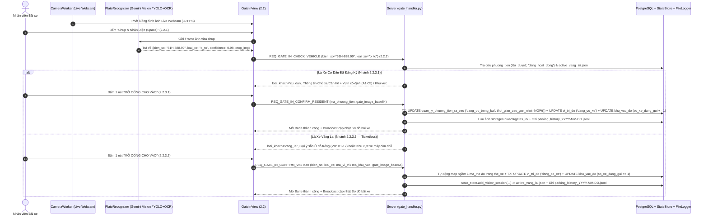
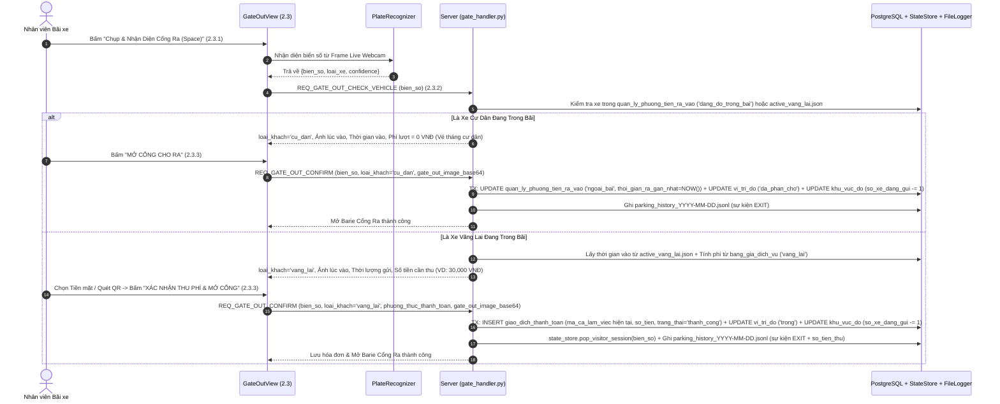

# Kế Hoạch Chi Tiết Thành Viên 5: Ny (`feat/gate-ai-ocr`)
**Vai trò:** Gate Control, Live Webcam AI License Plate Recognition (`OpenCV + Gemini Vision / YOLO + EasyOCR`), Ticketless Entry/Exit & Shift Revenue Engineer  
**Nhánh Git làm việc:** `feat/gate-ai-ocr`  
**Tổng số chức năng phụ trách:** **11 chức năng lá** (`2.2.1`, `2.2.2`, `2.2.3.1`, `2.2.3.2`, `2.3.1`, `2.3.2`, `2.3.3`, `2.4`, `2.5.1`, `2.5.2`, `2.5.3`) + **Trọn bộ AI Vision Pipeline (`client/ai/`)**

---

## 1. Tổng Quan Trọng Trách & Giải Pháp Tối Ưu Cho Đồ Án

**Thành viên 5 (Ny)** phụ trách luồng vận hành thực tế sôi động nhất khi demo đồ án: **Kiểm soát Cổng Vào / Cổng Ra tự động bằng Camera AI không dùng thẻ vật lý (Ticketless Smart Parking)**, **Tính phí gửi xe vãng lai**, **Quản lý doanh thu theo ca trực**, và **Tra cứu phương tiện tại chốt bảo vệ**:

1. **Chế độ Nguồn Camera Duy Nhất — `Live Webcam (OpenCV)` & Hybrid AI Engine Tối Ưu Nhất (`client/ai/`):**
   - Giao diện Cổng Vào (`2.2`) và Cổng Ra (`2.3`) sử dụng **1 chế độ nguồn hình ảnh trực tiếp là `Live Webcam` (`cv2.VideoCapture(0)`)** chạy trên `QThread` riêng (`CameraWorker`), đảm bảo video mượt `30 FPS`, không bao giờ làm đơ giao diện PySide6.
   - Khi Nhân viên bấm **"Chụp & Nhận Diện (`Space`)"**, khung hình Webcam được đưa vào `PlateRecognizer` với kiến trúc **2 tầng thông minh (Hybrid AI)**:
     - **Tầng 1 (Chính — `Gemini Flash Vision API` qua `GEMINI_API_KEY` trong `.env`):** Cực nhẹ máy, không cần GPU rời, nhận diện chính xác **~99% biển số Việt Nam** (cả biển 1 dòng ô tô và biển 2 dòng xe máy, kể cả khi giơ ảnh biển số trên màn hình điện thoại trước Webcam khi thuyết trình đồ án) chỉ trong `~0.8s`, trả về JSON `{bien_so, loai_xe, mau_xe, confidence, bbox}`.
     - **Tầng 2 (Fallback Local — `YOLO + EasyOCR`):** Tự động kích hoạt nếu máy không có Internet hoặc chưa điền `GEMINI_API_KEY`, cắt vùng biển số và đọc ký tự offline ngay trên CPU.
   - Nhân viên vẫn có thể chỉnh sửa nhanh chuỗi biển số trên ô kết quả nếu ánh sáng phòng quá chói/mờ trước khi bấm **"Mở Cổng"**.

2. **Kiểm Soát Cổng Vào Ticketless (`2.2.1–2.2.3.2` — `Workflow 03`):**
   - **Không dùng thẻ từ/thẻ nhựa truyền thống trên UI:** Hệ thống định danh 100% bằng **Biển số xe**. (Ở tầng CSDL dưới Server, hệ thống tự động gán ngầm 1 mã định danh phiên ảo trong bảng `the_xe` để thỏa mãn khóa ngoại `ma_the` của bảng `giao_dich_thanh_toan` trong bộ 18 bảng chuẩn mà không bắt nhân viên bảo vệ phải chọn hay phát thẻ).
   - **Nhánh `2.2.3.1` (Xe đã đăng ký của Cư dân):** Tự động hiển thị thông tin Chủ xe, Số căn hộ, Loại xe và Vị trí cố định (`ma_vi_tri_co_dinh` cho Ô tô) hoặc Khu vực phân công (`ma_khu_vuc_phan_cong` cho Xe máy). Nhân viên bấm 1 nút **"Mở Cổng Cho Vào"** $\rightarrow$ cập nhật `quan_ly_phuong_tien_ra_vao.trang_thai_hien_tai = 'dang_do_trong_bai'`, đổi `vi_tri_do` sang `'dang_co_xe'`, tăng `khu_vuc_do.so_xe_dang_gui += 1`, lưu ảnh cổng vào (`storage/uploads/gates_in/`) và ghi `parking_history_YYYY-MM-DD.jsonl`.
   - **Nhánh `2.2.3.2` (Xe Vãng lai):** Tự động gợi ý sẵn **1 Ô đỗ trống đầu tiên** (nếu là Ô tô vãng lai) hoặc **Khu vực xe máy còn chỗ** (nhân viên có thể đổi nhanh nếu muốn) $\rightarrow$ bấm 1 nút **"Mở Cổng Cho Vào"** $\rightarrow$ lưu phiên gửi xe vãng lai vào RAM Server + đồng bộ xuống `storage/state/active_vang_lai.json`, cập nhật `vi_tri_do` / `khu_vuc_do` và ghi log.

3. **Kiểm Soát Cổng Ra & Thu Phí Vãng Lai Tự Động (`2.3.1–2.3.3` — `Workflow 04`):**
   - Chụp ảnh từ Live Webcam & nhận diện biển số (`2.3.1`), đối chiếu với phiên gửi xe đang mở (`2.3.2`):
     - **Xe Cư Dân:** Đã đóng phí tháng $\rightarrow$ hiển thị `"XE CƯ DÂN — MIỄN THU PHÍ LƯỢT (0 đ)"` $\rightarrow$ bấm **"Mở Cổng Cho Ra"** (`2.3.3`) $\rightarrow$ trả `vi_tri_do` về `'da_phan_cho'` (giữ chỗ cố định cho căn hộ), giảm `khu_vuc_do.so_xe_dang_gui -= 1`, đổi `quan_ly_phuong_tien_ra_vao` sang `'ngoai_bai'`, ghi `parking_history_YYYY-MM-DD.jsonl`.
     - **Xe Vãng Lai:** Tự động tính thời gian lưu bãi và tính tiền theo `bang_gia_dich_vu` (`loai_khach_ap_dung = 'vang_lai'`, làm tròn tối thiểu 1 lượt/block đầu để khi demo vừa cho xe vào rồi cho ra ngay vẫn tính ra số tiền chuẩn đẹp). Hỗ trợ chọn **Tiền mặt (`tien_mat`)** hoặc **Quét QR (`chuyen_khoan_qr`)** $\rightarrow$ bấm **"Xác Nhận Thu Phí & Mở Cổng"** (`2.3.3`) $\rightarrow$ ghi vào bảng `giao_dich_thanh_toan` (gắn với `ma_ca_lam_viec` đang mở), xóa khỏi `active_vang_lai.json`, trả `vi_tri_do` về `'trong'`, giảm `so_xe_dang_gui -= 1`, và ghi `parking_history_YYYY-MM-DD.jsonl`.

4. **Quản Lý Ca Làm Việc & Tổng Doanh Thu Theo Ca (`2.4`) + Tra Cứu Phương Tiện (`2.5.1–2.5.3`):**
   - Tự động mở `ca_lam_viec` (`Ca Sáng` / `Ca Chiều` / `Ca Đêm` theo giờ hệ thống) ngay khi Nhân viên đăng nhập hoặc vào ca trực nếu chưa có ca `'dang_mo'`.
   - Màn hình `2.4`: Hiển thị KPI Tổng doanh thu ca hiện tại (tổng tiền, tiền mặt, QR, số lượt xe), bảng chi tiết từng giao dịch thu phí trong ca, lịch sử các ca trước của nhân viên, và nút **"Kết thúc ca (Chốt ca)"**.
   - Màn hình `2.5`: Tra cứu tức thì theo biển số (`2.5.1`) cho cả xe Cư dân & Vãng lai, xem trạng thái đang ở trong hay ngoài bãi + vị trí đỗ (`2.5.2`), và xem lịch sử vào/ra gần đây kèm ảnh chụp tại cổng (`2.5.3`).

---

## 2. Danh Sách File Thành Viên 5 (Ny) Phụ Trách

```text
smart_parking/
├── server/
│   └── handlers/
│       └── gate_handler.py                   # [Ny] Xử lý Workflow 03 (2.2.1-2.2.3.2), Workflow 04 (2.3.1-2.3.3), Ca làm & Doanh thu (2.4), Tra cứu xe (2.5.1-2.5.3)
│
├── client/
│   ├── ai/
│   │   ├── camera_worker.py                  # [Ny] QThread đọc Live Webcam (cv2.VideoCapture) mượt 30 FPS & chụp Frame sắc nét
│   │   └── plate_recognizer.py               # [Ny] QThread Hybrid AI: Gemini Flash Vision API (ưu tiên 1) + YOLO/EasyOCR (fallback offline)
│   └── ui/
│       └── staff/
│           ├── gate_in_view.py               # [Ny] 2.2.1 - 2.2.3.2: Giao diện Cổng Vào Live Webcam + Tự động phân nhánh Cư dân / Vãng lai (Ticketless)
│           ├── gate_out_view.py              # [Ny] 2.3.1 - 2.3.3: Giao diện Cổng Ra Live Webcam + Đối chiếu ảnh Vào/Ra + Tính phí & Mở cổng
│           ├── shift_revenue_view.py         # [Ny] 2.4: Thông tin Ca trực hiện tại, KPI Doanh thu ca, Chi tiết giao dịch & Chốt ca
│           └── staff_lookup_view.py          # [Ny] 2.5.1 - 2.5.3: Tra cứu biển số, Trạng thái trong/ngoài bãi & Lịch sử vào/ra kèm ảnh chụp cổng
│
└── tests/
    └── test_gate_ai.py                       # [Ny] Unit/Integration test cho chuẩn hóa OCR, Workflow 03, Workflow 04, Tính phí vãng lai & Doanh thu ca
```

---

## 3. Sơ Đồ Luồng Nghiệp Vụ Cổng Vào (`Workflow 03`) & Cổng Ra (`Workflow 04`)

### 3.1. Sơ đồ Tuần tự Kiểm soát Cổng Vào Ticketless (`Workflow 03`: `2.2.1–2.2.3.2`)



### 3.2. Sơ đồ Tuần tự Kiểm soát Cổng Ra & Thu phí Vãng lai (`Workflow 04`: `2.3.1–2.3.3`)



---

## 4. Đặc Tả Chi Tiết Từng File & Từng Chức Năng (`11 Chức Năng Lá + AI Module`)

### 4.1. `client/ai/camera_worker.py` — Luồng Đọc Live Webcam (`OpenCV QThread`)
- **Lớp `CameraWorker(QThread)`**:
  - **Signals:**
    - `frame_ready = Signal(QImage, object)`: Phát `QImage` (để hiển thị lên `QLabel` video preview) và `numpy.ndarray` BGR gốc mỗi ~33ms (`30 FPS`).
    - `camera_error = Signal(str)`: Phát thông báo nếu không tìm thấy Webcam hoặc Webcam đang bị ứng dụng khác chiếm.
  - **Phương thức chính:**
    - `start_camera(camera_index: int = 0)`: Mở `cv2.VideoCapture(camera_index, cv2.CAP_DSHOW)` (tối ưu khởi động nhanh trên Windows), cấu hình độ phân giải `1280x720`.
    - `capture_snapshot() -> np.ndarray | None`: Trả về bản sao (`frame.copy()`) sắc nét của khung hình hiện tại ngay khi nhân viên bấm nút Chụp hoặc phím `Space`.
    - `stop_camera()`: Giải phóng `cap.release()` an toàn khi đóng màn hình hoặc chuyển sang màn hình khác.

---

### 4.2. `client/ai/plate_recognizer.py` — Engine AI Nhận Diện Biển Số Hybrid (`Gemini Vision API` + `YOLO/EasyOCR`)
- **Lớp `PlateRecognitionWorker(QThread)`**:
  - Chạy bất đồng bộ trên thread riêng mỗi khi nhận một `frame` từ `CameraWorker.capture_snapshot()`, phát `recognition_finished = Signal(dict)` trả về:
    ```python
    {
        "success": True,
        "bien_so": "51H-888.99",      # Đã chuẩn hóa qua shared/validators.py
        "loai_xe": "o_to",            # 'o_to' hoặc 'xe_may'
        "confidence": 0.98,           # Độ tin cậy (0.0 -> 1.0)
        "engine_used": "Gemini Vision AI", # hoặc "YOLO + EasyOCR"
        "plate_crop_qimage": QImage,  # Ảnh vùng biển số đã cắt
        "raw_text": "51H-888.99",
        "elapsed_ms": 780
    }
    ```
  - **Cơ chế hoạt động 2 tầng tối ưu:**
    1. **Tầng 1 — `recognize_with_gemini_vision(frame_bgr)`:**
       - Kiểm tra biến môi trường `GEMINI_API_KEY` trong `.env`. Nếu có key:
       - Nén nhanh ảnh JPEG chất lượng 85% trong bộ nhớ, gọi `google-genai` (`gemini-2.5-flash`) với System Prompt chuyên biệt cho biển số xe Việt Nam, yêu cầu trả về JSON nghiêm ngặt `{ "bien_so": "...", "loai_xe": "o_to" | "xe_may", "confidence": 0.98, "bbox": [ymin, xmin, ymax, xmax] }`.
       - Cắt ảnh vùng biển số (`plate_crop`) theo `bbox` để hiển thị lên ô "Ảnh cắt biển số" trên UI.
    2. **Tầng 2 (Fallback tự động) — `recognize_with_yolo_easyocr(frame_bgr)`:**
       - Nếu không cấu hình `GEMINI_API_KEY` hoặc lỗi kết nối mạng, tự động dùng `YOLO` phát hiện vùng biển số (hoặc OpenCV contour/aspect-ratio plate detector) kết hợp `easyocr.Reader(['en'], gpu=False)` để đọc các ký tự chữ và số.
    3. **Hậu xử lý & Chuẩn hóa Biển số Việt Nam (`post_process_plate_text`):**
       - Tự động sửa các lỗi OCR phổ biến ở vị trí chữ cái mã tỉnh (ký tự thứ 3): ví dụ `0 -> D`, `8 -> B`, `5 -> S`, `1 -> A/F` tùy ngữ cảnh và chuẩn hóa sang định dạng chuẩn của hệ thống (VD: `59A112345` $\rightarrow$ `59A1-123.45`, `30H88899` $\rightarrow$ `30H-888.99`).

---

### 4.3. `server/handlers/gate_handler.py` — Backend Kiểm Soát Cổng Vào/Ra, Tính Phí & Doanh Thu Ca

#### A. Quản lý Ca Làm Việc Tự Động & Doanh Thu Theo Ca (`2.4`)
1. **Hàm nội bộ `_ensure_open_shift(cur, ma_nhan_vien) -> dict`**:
   - Kiểm tra xem `ma_nhan_vien` đang có dòng nào trong bảng `ca_lam_viec` với `trang_thai_ca = 'dang_mo'` hay chưa.
   - Nếu chưa có: Tự động xác định `ten_ca` theo giờ hiện tại (`06:00–14:00`: `'Ca Sáng'`, `14:00–22:00`: `'Ca Chiều'`, `22:00–06:00`: `'Ca Đêm'`), thực thi `INSERT INTO ca_lam_viec (ma_nhan_vien, ten_ca, gio_bat_dau, trang_thai_ca) VALUES (%s, %s, NOW(), 'dang_mo') RETURNING *`.
2. **`REQ_STAFF_GET_SHIFT_REVENUE` (`2.4 Xem tổng doanh thu theo ca làm`)**:
   - **Input:** `ma_nhan_vien` (từ session), `ma_ca_lam_viec` (tùy chọn — mặc định lấy ca đang mở hiện tại).
   - **Output:**
     - Thông tin ca trực hiện tại (`ma_ca_lam_viec`, `ten_ca`, `gio_bat_dau`, `ho_ten` nhân viên).
     - **KPI Doanh thu trong ca:**
       - `tong_doanh_thu`: Tổng `so_tien` trong `giao_dich_thanh_toan` có `ma_ca_lam_viec` hiện tại và `trang_thai_giao_dich = 'thanh_cong'`.
       - `doanh_thu_tien_mat`: Tổng tiền thanh toán bằng `'tien_mat'`.
       - `doanh_thu_qr`: Tổng tiền thanh toán bằng `'chuyen_khoan_qr'`.
       - `so_luot_thu_phi`: Tổng số giao dịch trong ca (tách theo Ô tô / Xe máy).
     - **Danh sách chi tiết các giao dịch trong ca:** Truy vấn `giao_dich_thanh_toan` kết hợp thông tin biển số từ log/phiên giao dịch.
     - **Lịch sử các ca trực trước của nhân viên:** Danh sách `ca_lam_viec` kèm tổng doanh thu từng ca.
3. **`REQ_STAFF_CLOSE_SHIFT` (Chốt ca & Kết thúc ca trực tại màn hình `2.4`)**:
   - Cập nhật `UPDATE ca_lam_viec SET gio_ket_thuc = NOW(), trang_thai_ca = 'da_dong' WHERE ma_ca_lam_viec = %s AND ma_nhan_vien = %s`.
   - Ghi `file_logger.log_audit(...)` lưu vết tổng số tiền bàn giao cuối ca.

---

#### B. Kiểm Soát Cổng Vào (`2.2.1–2.2.3.2` — `Workflow 03`)
1. **`REQ_GATE_IN_CHECK_VEHICLE` (`2.2.1`, `2.2.2`)**:
   - **Input:** `bien_so`, `loai_xe_nhan_dien` (`'o_to'` | `'xe_may'`).
   - **Xử lý kiểm tra toàn diện:**
     - Chuẩn hóa `bien_so`.
     - **Kiểm tra xe đã ở trong bãi chưa (Anti-Passback):**
       - Kiểm tra trong `quan_ly_phuong_tien_ra_vao` (`trang_thai_hien_tai == 'dang_do_trong_bai'`) và trong `state_store.get_visitor_by_plate(bien_so)`.
       - Nếu xe đang ở trong bãi: Trả về cảnh báo `"Biển số này đang được ghi nhận ở TRONG BÃI từ lúc ...! Không thể cho vào trùng lặp."`
     - **Kiểm tra trong bảng `phuong_tien`:**
       - Nếu tìm thấy xe có `trang_thai_dang_ky == 'da_duyet'` và `trang_thai_hoat_dong == 'dang_hoat_dong'`:
         - Trả về `phan_nhanh = 'cu_dan'` (`2.2.3.1`), kèm đầy đủ thông tin: Chủ xe (`ho_ten`, `so_dien_thoai`), Căn hộ (`so_can_ho`, `toa_nha`), Loại xe (`loai_xe`), Vị trí cố định (`ma_vi_tri_co_dinh`, `ma_vi_tri_code`) hoặc Khu vực phân công (`ma_khu_vuc_phan_cong`, `ten_khu_vuc`).
       - Nếu không tìm thấy (hoặc xe đã ngừng hoạt động):
         - Trả về `phan_nhanh = 'vang_lai'` (`2.2.3.2`), kèm:
           - **Gợi ý sẵn Vị trí / Khu vực đỗ trống:**
             - Nếu `loai_xe == 'o_to'`: Lấy danh sách các ô đỗ ô tô đang `'trong'` (`vi_tri_do.trang_thai_vi_tri = 'trong'` thuộc khu vực `'o_to'` đang `'hoat_dong'`), chọn sẵn ô đầu tiên làm gợi ý mặc định.
             - Nếu `loai_xe == 'xe_may'`: Lấy danh sách các khu vực xe máy đang `'hoat_dong'` và còn chỗ trống (`so_cho_trong > 0`), chọn sẵn khu vực đầu tiên làm gợi ý mặc định.

2. **`REQ_GATE_IN_CONFIRM_ENTRY` (`2.2.3.1` & `2.2.3.2`)**:
   - **Input:** `bien_so`, `loai_khach` (`'cu_dan'` | `'vang_lai'`), `loai_xe`, `ma_phuong_tien` (nếu là cư dân), `ma_vi_tri` (nếu là ô tô), `ma_khu_vuc`, `gate_image_base64`.
   - **Transaction ACID & Lưu Trạng Thái:**
     - Lưu ảnh chụp tại cổng vào xuống `storage/uploads/gates_in/in_{bien_so}_{timestamp}.jpg`.
     - **Nếu `loai_khach == 'cu_dan'` (`2.2.3.1`):**
       - `UPDATE quan_ly_phuong_tien_ra_vao SET trang_thai_hien_tai = 'dang_do_trong_bai', ma_vi_tri_hien_tai = ma_vi_tri_co_dinh, thoi_gian_vao_gan_nhat = NOW() WHERE ma_phuong_tien = %s`.
       - Nếu là Ô tô có `ma_vi_tri_co_dinh`: `UPDATE vi_tri_do SET trang_thai_vi_tri = 'dang_co_xe' WHERE ma_vi_tri = %s`.
       - Tăng số xe trong khu vực: `UPDATE khu_vuc_do SET so_xe_dang_gui = so_xe_dang_gui + 1, so_cho_trong = GREATEST(0, so_cho_trong - 1) WHERE ma_khu_vuc = %s`.
     - **Nếu `loai_khach == 'vang_lai'` (`2.2.3.2` — Ticketless):**
       - Tự động lấy (hoặc khởi tạo ngầm) 1 bản ghi `ma_the` ảo đang `'hoat_dong'` trong bảng `the_xe` (đúng `loai_xe_ap_dung`) để liên kết ngầm cho phiên gửi xe mà không yêu cầu nhân viên chọn thẻ trên giao diện.
       - Nếu là Ô tô vãng lai: Kiểm tra `vi_tri_do` đang `'trong'`, `UPDATE vi_tri_do SET trang_thai_vi_tri = 'dang_co_xe' WHERE ma_vi_tri = %s`.
       - Cập nhật khu vực: `UPDATE khu_vuc_do SET so_xe_dang_gui = so_xe_dang_gui + 1, so_cho_trong = GREATEST(0, so_cho_trong - 1) WHERE ma_khu_vuc = %s`.
       - Lưu phiên vãng lai vào RAM + `storage/state/active_vang_lai.json` qua `state_store.add_visitor_session(...)` (gồm `bien_so`, `loai_xe`, `ma_the`, `ma_khu_vuc`, `ten_khu_vuc`, `ma_vi_tri`, `ma_vi_tri_code`, `thoi_gian_vao`, `ma_nhan_vien_vao`, `anh_cong_vao`).
     - Ghi sự kiện `ENTRY` vào `file_logger.log_parking_history(...)`.
     - Phát sự kiện cập nhật realtime tới các màn hình Giám sát bãi xe (`1.6` / `2.6`) đang mở.

---

#### C. Kiểm Soát Cổng Ra & Tính Phí Vãng Lai (`2.3.1–2.3.3` — `Workflow 04`)
1. **`REQ_GATE_OUT_CHECK_VEHICLE` (`2.3.1`, `2.3.2`)**:
   - **Input:** `bien_so`.
   - **Xử lý đối chiếu & Tính phí:**
     - **Trường hợp 1 — Tìm thấy trong `quan_ly_phuong_tien_ra_vao` (`trang_thai_hien_tai == 'dang_do_trong_bai'`):**
       - Là **Xe Cư Dân**: Lấy thông tin chủ xe, căn hộ, `thoi_gian_vao_gan_nhat`, ảnh chụp lúc vào cổng (từ `parking_history_*.jsonl`), vị trí/khu vực đang đỗ.
       - Số tiền thu tại cổng: `0 VNĐ` (Đã bao gồm trong hóa đơn phí gửi xe hàng tháng của căn hộ).
     - **Trường hợp 2 — Tìm thấy trong `state_store.get_visitor_by_plate(bien_so)` (`active_vang_lai.json`):**
       - Là **Xe Vãng Lai**: Lấy `thoi_gian_vao`, `loai_xe`, `ma_vi_tri`, `ma_khu_vuc`, `anh_cong_vao`.
       - Truy vấn bảng giá hiệu lực trong `bang_gia_dich_vu` (`loai_khach_ap_dung = 'vang_lai'`, `loai_xe = session.loai_xe`, `trang_thai_ap_dung = 'dang_ap_dung'`).
       - **Công thức tính phí thông minh (`_calculate_visitor_fee`):**
         - Tính `so_phut_gui = max(1, int((now - thoi_gian_vao).total_seconds() // 60))` và `so_gio_gui = math.ceil(so_phut_gui / 60.0)`.
         - Nếu bảng giá đang áp dụng `don_vi_tinh == 'gio'`: `so_tien = so_gio_gui * gia_tien`.
         - Nếu bảng giá đang áp dụng `don_vi_tinh == 'luot'`: Mỗi block 4 giờ tính 1 lượt (`so_luot = max(1, math.ceil(so_gio_gui / 4.0))`), `so_tien = so_luot * gia_tien`.
         - Nếu bảng giá đang áp dụng `don_vi_tinh == 'ngay_dem'`: Mỗi 24 giờ tính 1 ngày đêm (`so_ngay = max(1, math.ceil(so_gio_gui / 24.0))`), `so_tien = so_ngay * gia_tien`.
       - Trả về đầy đủ bảng kê: `thoi_gian_vao`, `thoi_gian_ra`, `thoi_luong_text` (VD: `"2 giờ 15 phút"`), `don_gia`, `so_tien_phai_thu`, và `anh_cong_vao_base64` để nhân viên đối chiếu trực quan ảnh xe lúc vào và lúc ra.
     - **Trường hợp 3 — Không tìm thấy xe đang đỗ trong bãi:**
       - Trả về lỗi rõ ràng `"Không tìm thấy phiên gửi xe đang mở trong bãi cho biển số này!"` để nhân viên kiểm tra lại ký tự biển số.

2. **`REQ_GATE_OUT_CONFIRM_EXIT` (`2.3.3`)**:
   - **Input:** `bien_so`, `loai_khach` (`'cu_dan'` | `'vang_lai'`), `phuong_thuc_thanh_toan` (`'tien_mat'` | `'chuyen_khoan_qr'`), `gate_out_image_base64`.
   - **Transaction ACID:**
     - Lưu ảnh chụp cổng ra xuống `storage/uploads/gates_out/out_{bien_so}_{timestamp}.jpg`.
     - Đảm bảo nhân viên đang có `ca_lam_viec` mở (`_ensure_open_shift`).
     - **Nếu `loai_khach == 'cu_dan'`:**
       - `UPDATE quan_ly_phuong_tien_ra_vao SET trang_thai_hien_tai = 'ngoai_bai', ma_vi_tri_hien_tai = NULL, thoi_gian_ra_gan_nhat = NOW() WHERE ma_phuong_tien = %s`.
       - Nếu là Ô tô có `ma_vi_tri_co_dinh`: Trả trạng thái ô đỗ từ `'dang_co_xe'` về `'da_phan_cho'` (`UPDATE vi_tri_do SET trang_thai_vi_tri = 'da_phan_cho' WHERE ma_vi_tri = %s`).
       - Giảm số xe trong khu vực: `UPDATE khu_vuc_do SET so_xe_dang_gui = GREATEST(0, so_xe_dang_gui - 1), so_cho_trong = LEAST(suc_chua_toi_da, so_cho_trong + 1) WHERE ma_khu_vuc = %s`.
     - **Nếu `loai_khach == 'vang_lai'`:**
       - Lấy phiên gửi xe từ `state_store.get_visitor_by_plate(bien_so)` và tính lại số tiền chính xác từ `bang_gia_dich_vu`.
       - Ghi nhận giao dịch vào bảng `giao_dich_thanh_toan`:
         ```sql
         INSERT INTO giao_dich_thanh_toan (
             loai_giao_dich, ma_hoa_don, ma_the, ma_ca_lam_viec, ma_nhan_vien_thu,
             so_tien, phuong_thuc_thanh_toan, thoi_gian_thanh_toan, trang_thai_giao_dich, ma_tham_chieu, ghi_chu
         ) VALUES (
             'phi_luot_vang_lai', NULL, %s, %s, %s,
             %s, %s, NOW(), 'thanh_cong', %s, %s
         ) RETURNING ma_giao_dich;
         ```
       - Nếu là Ô tô vãng lai có `ma_vi_tri`: Trả trạng thái ô đỗ về `'trong'` (`UPDATE vi_tri_do SET trang_thai_vi_tri = 'trong' WHERE ma_vi_tri = %s`).
       - Giảm số xe trong khu vực: `UPDATE khu_vuc_do SET so_xe_dang_gui = GREATEST(0, so_xe_dang_gui - 1), so_cho_trong = LEAST(suc_chua_toi_da, so_cho_trong + 1) WHERE ma_khu_vuc = %s`.
       - Xóa phiên gửi xe khỏi `active_vang_lai.json` qua `state_store.pop_visitor_session(bien_so)`.
     - Ghi sự kiện `EXIT` (kèm `so_tien_thu`, `ma_giao_dich`, `anh_cong_vao`, `anh_cong_ra`) vào `file_logger.log_parking_history(...)`.

---

#### D. Tra Cứu Phương Tiện Của Nhân Viên Bãi Xe (`2.5.1–2.5.3`)
1. **`REQ_STAFF_LOOKUP_VEHICLE` (`2.5.1`, `2.5.2`, `2.5.3`)**:
   - **Input:** `search_plate` (biển số cần tìm — hỗ trợ tìm gần đúng `ILIKE %plate%`), `trang_thai_filter` (`'all'` | `'dang_do_trong_bai'` | `'ngoai_bai'`), `loai_khach_filter` (`'all'` | `'cu_dan'` | `'vang_lai'`).
   - **Xử lý kết hợp 3 nguồn dữ liệu:**
     1. **Xe Cư Dân (`phuong_tien` JOIN `quan_ly_phuong_tien_ra_vao`, `cu_dan`, `can_ho`, `vi_tri_do`, `khu_vuc_do`):** Biết ngay xe đang ở trong bãi hay ngoài bãi (`2.5.2`), ô đỗ cố định/hiện tại, thông tin chủ xe để liên hệ khi cần.
     2. **Xe Vãng Lai đang trong bãi (`state_store.list_visitor_sessions()`):** Biết ngay thời gian vào, vị trí/khu vực đỗ hiện tại (`2.5.2`).
     3. **Lịch sử vào/ra gần đây của xe (`2.5.3`):** Truy vấn từ `file_logger.query_logs("parking_history", ...)` trả về danh sách các lượt vào/ra gần nhất kèm ảnh chụp tại cổng (`gates_in` / `gates_out`).

---

### 4.4. Thiết Kế Chi Tiết Giao Diện PySide6 (`client/ui/staff/...`)

#### A. `client/ui/staff/gate_in_view.py` — Màn Hình Kiểm Soát Cổng Vào (`2.2.1–2.2.3.2`)
- **Bố cục Split-Screen 2 Cột chuẩn Trạm Kiểm Soát Thông Minh:**
  - **Cột Trái (55% — Live Webcam & AI Plate Reader `2.2.1`):**
    - Khung hiển thị video trực tiếp từ `CameraWorker` (`Live Webcam — Cổng Vào`) có vẽ khung ngắm (Viewfinder reticle) ở giữa để dễ đưa biển số vào vùng nhận diện.
    - Nút lớn **"CHỤP & NHẬN DIỆN BIỂN SỐ (`Phím Space`)"** màu Xanh Royal (`#2563EB`).
    - Khu vực kết quả AI ngay bên dưới khung video:
      - Hiển thị **Ảnh cắt biển số (Cropped Plate)** + **Badge Engine & Độ tin cậy** (VD: `Gemini Vision AI • 99%`).
      - Ô hiển thị/chỉnh sửa nhanh **Biển số xe** (Font `JetBrains Mono` `24px` Bold) + nút **"Tra cứu lại"** (nếu nhân viên vừa sửa tay 1 ký tự).
  - **Cột Phải (45% — Kết quả Phân loại Tự động `2.2.2` & Điều khiển Mở Cổng `2.2.3.1 / 2.2.3.2`):**
    - Tự động chuyển trạng thái Card theo kết quả Server trả về:
      - **Khi là XE CƯ DÂN (`2.2.3.1`):** Hiển thị Banner Xanh Lá `"XE ĐÃ ĐĂNG KÝ CỦA CƯ DÂN"` + Họ tên chủ xe, Căn hộ, Loại xe, và **Vị trí đỗ cố định / Khu vực phân công**.
      - **Khi là XE VÃNG LAI (`2.2.3.2` — Ticketless):** Hiển thị Banner Xanh Dương `"KHÁCH VÃNG LAI (ĐỊNH DANH BIỂN SỐ)"` + Chọn loại xe (`Ô tô` / `Xe máy`) + Dropdown **Vị trí đỗ trống / Khu vực đỗ** đã được hệ thống **tự động điền sẵn ô trống đầu tiên**.
    - Nút hành động chính khổng lồ ở đáy cột phải: **"MỞ CỔNG CHO VÀO (`Enter`)"** màu Xanh Emerald (`#16A34A`) kèm hiệu ứng mô phỏng trạng thái Barie (`ĐANG MỞ BARIE...` $\rightarrow$ `ĐÃ QUA CỔNG`).

#### B. `client/ui/staff/gate_out_view.py` — Màn Hình Kiểm Soát Cổng Ra & Thu Phí (`2.3.1–2.3.3`)
- **Bố cục Split-Screen 2 Cột đối xứng:**
  - **Cột Trái (55% — Live Webcam Cổng Ra `2.3.1` & Đối chiếu Ảnh Vào / Ảnh Ra):**
    - Khung video `Live Webcam — Cổng Ra` + Nút **"CHỤP & NHẬN DIỆN CỔNG RA (`Phím Space`)"**.
    - Hàng đối chiếu trực quan 2 ảnh cạnh nhau: **[Ảnh chụp lúc VÀO bãi]** vs **[Ảnh chụp lúc RA bãi]** để nhân viên bảo vệ kiểm tra đúng xe trong 1 ánh nhìn.
  - **Cột Phải (45% — Bảng Tính Phí Tự Động `2.3.2` & Xác Nhận Mở Cổng `2.3.3`):**
    - Hiển thị thông tin phiên gửi xe: Biển số, Loại khách (`Cư dân` / `Vãng lai`), Giờ vào, Giờ ra, Tổng thời gian lưu bãi.
    - **Khung Tổng Tiền Phải Thu:**
      - Nếu là **Xe Cư Dân**: Hiển thị `0 VNĐ (Đã đóng phí tháng)` $\rightarrow$ Nút **"MỞ CỔNG CHO RA (`Enter`)"**.
      - Nếu là **Xe Vãng Lai**: Hiển thị số tiền chữ lớn (VD: `30,000 VNĐ`), công thức đơn giá áp dụng, nút chọn phương thức thanh toán (**`Tiền mặt`** hoặc **`Quét mã QR`** — nếu bấm Quét QR sẽ bật ngay mã QR chứa số tiền để khách quét) $\rightarrow$ Nút **"XÁC NHẬN THU PHÍ & MỞ CỔNG (`Enter`)"**.

#### C. `client/ui/staff/shift_revenue_view.py` — Màn Hình Doanh Thu Theo Ca Làm (`2.4`)
- **Header Ca Trực:** Hiển thị tên nhân viên, Mã ca, Tên ca (`Ca Sáng / Chiều / Đêm`), Thời gian bắt đầu ca, Trạng thái `ĐANG MỞ`, và nút **"Chốt Ca & Kết Thúc Ca Trực"**.
- **4 Thẻ KPI (`StatCard`):**
  1. `Tổng Doanh Thu Ca Hiện Tại (VNĐ)`
  2. `Thu Tiền Mặt (VNĐ)`
  3. `Thu Chuyển Khoản QR (VNĐ)`
  4. `Tổng Số Lượt Xe Vãng Lai Đã Thu`
- **2 Bảng Dữ Liệu:**
  - Bảng trên: Danh sách chi tiết từng giao dịch thu phí trong ca đang chọn (Mã GD, Thời gian, Biển số, Loại xe, Phương thức, Số tiền).
  - Bảng dưới: Lịch sử các ca làm việc trước đó của nhân viên (bấm vào ca nào sẽ xem lại được chi tiết giao dịch của ca đó).

#### D. `client/ui/staff/staff_lookup_view.py` — Màn Hình Tra Cứu Phương Tiện Của Nhân Viên (`2.5.1–2.5.3`)
- **Thanh tìm kiếm & Bộ lọc nhanh (`2.5.1`):** Ô nhập biển số xe + Lọc trạng thái (`Tất cả` / `Đang đỗ trong bãi` / `Ngoài bãi`) + Lọc loại khách (`Tất cả` / `Xe cư dân` / `Xe vãng lai`).
- **Bảng Kết quả Phương tiện & Trạng thái hiện tại (`2.5.2`):** Hiển thị Biển số, Loại xe, Phân loại (`Cư dân căn hộ ...` hoặc `Khách vãng lai`), Trạng thái (`ĐANG ĐỖ TRONG BÃI` / `NGOÀI BÃI`), Vị trí ô đỗ / Khu vực hiện tại, Giờ vào gần nhất.
- **Panel Chi tiết & Lịch sử vào/ra kèm ảnh chụp cổng (`2.5.3`):** Khi click vào 1 xe trong bảng, cột phải hiển thị danh sách các lượt vào/ra gần đây của biển số đó và cho phép xem lại ảnh chụp thực tế tại cổng vào/ra (`gates_in` / `gates_out`).

---

## 5. Kế Hoạch Kiểm Thử & Nghiệm Thu Cho Thành Viên 5 (`tests/test_gate_ai.py`)

1. **Test Chuẩn hóa Biển số & AI Recognizer (`plate_recognizer.py`):**
   - Kiểm tra hàm hậu xử lý OCR chuẩn hóa đúng các chuỗi thô (`"51H88899"` $\rightarrow$ `"51H-888.99"`, `"59A112345"` $\rightarrow$ `"59A1-123.45"`) và phân biệt đúng `o_to` vs `xe_may`.
2. **Test Luồng Cổng Vào & Cổng Ra Xe Cư Dân (`Workflow 03` Nhánh `2.2.3.1` & `Workflow 04`):**
   - Cho xe cư dân vào bãi $\rightarrow$ kiểm tra `quan_ly_phuong_tien_ra_vao.trang_thai_hien_tai == 'dang_do_trong_bai'`, `vi_tri_do == 'dang_co_xe'`, `khu_vuc_do.so_xe_dang_gui` tăng `1`.
   - Thử cho cùng biển số đó vào bãi lần nữa khi chưa ra $\rightarrow$ Server phải chặn (Anti-Passback).
   - Cho xe cư dân ra bãi $\rightarrow$ phí lượt bằng `0`, `trang_thai_hien_tai == 'ngoai_bai'`, `vi_tri_do` trở về `'da_phan_cho'`.
3. **Test Luồng Cổng Vào & Cổng Ra Xe Vãng Lai Ticketless + Doanh Thu Ca (`Workflow 03` Nhánh `2.2.3.2`, `Workflow 04` & `2.4`):**
   - Cho xe ô tô vãng lai vào bãi $\rightarrow$ kiểm tra phiên gửi xe được lưu vào `storage/state/active_vang_lai.json` và ô đỗ chuyển sang `'dang_co_xe'`.
   - Cho xe ô tô vãng lai ra bãi $\rightarrow$ kiểm tra số tiền được tính tự động theo `bang_gia_dich_vu`, bản ghi `giao_dich_thanh_toan` được tạo gắn với `ma_ca_lam_viec` đang mở, phiên gửi xe được xóa khỏi `active_vang_lai.json`, ô đỗ trở về `'trong'`, và tổng doanh thu ca (`2.4`) tăng đúng bằng số tiền vừa thu.
